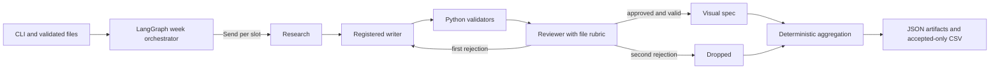

# Architecture

The outer `StateGraph` dispatches six independent slots with `Send`. Each slot invokes a typed inner `StateGraph` with conditional routing. Workers return one `SlotResult` each through a list reducer; the exporter sorts them by original plan order. A worker catches its own exception and returns a failed result, so unrelated workers complete. The inner graph allows two writes and two reviews at most; its recursion limit is fixed.

Research selects a KB entry, preserving its evidence ID, excerpt, and URL. Empty focuses choose a deterministic entry by slot index; explicit focuses match KB names, categories, and descriptions. Research and Reviewer invoke the same `EvidenceLookup` skill. Every tweet sentence has an exact-text claim record and at least one known evidence ID. The reviewer compares the tweet's meaning against evidence excerpts. External source text is presented as data, not as an instruction.

The model factory owns a process-wide asyncio semaphore. Slot workflows can overlap, while default inference concurrency is one. Calls use `ChatOllama.with_structured_output`, a timeout, Pydantic parsing, and returned token metadata. A model call failure fails its slot. Transient transport failures and timeouts receive at most one configured retry by default. Content revision after a review rejection is separate from these transport retries; schema or semantic failures are not transport retries.

Python checks schemas, tweet count and length, banned punctuation and phrases, hashtags, allowed links, citation IDs, and that each claimed support quote appears verbatim in the cited evidence excerpt. The reviewer judges whether that quote actually supports the full claim, plus technical correctness, brand voice, clarity, platform format, and usefulness using `instructions/reviewer-rubric.md`. Code enforces the score thresholds even if the review's `approved` flag is inconsistent. Visual specifications run only after both gates pass.

The registry maps post types to instruction files and length rules. Adding a conventional X post type requires a registry entry and instruction file. To scale to 15 slots, relax the weekly plan validator, retain the same `Send` fan-out and result reducer, and tune the inference semaphore after measuring resource use. Another platform needs its own writer instructions and deterministic format rules (character limits, links, thread structure) in the registry and validator adapter. The export contract would need a platform field in a separate format, since this assignment's CSV is fixed at two columns.

