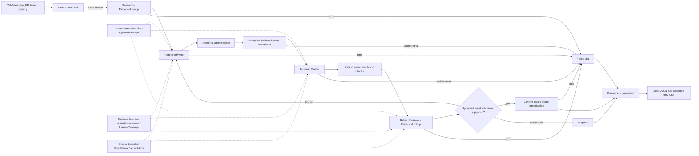

# Architecture

The outer LangGraph `StateGraph` sends one typed `PieceState` per slot. Each piece graph follows explicit node handoffs and conditional routing. Results are sorted back to plan order. A failed worker produces its own failed result; other slots continue. There are at most two content drafts per slot. Transport retries are separate and bounded. The default inference limit is one active Ollama request; local CLI processes also share a file lock at that setting. The graphs may schedule slots concurrently, but that does not imply concurrent model generation.

## Roles and trust boundaries

`ResearchAgent` resolves the focus against the KB through `EvidenceLookup`; an empty focus selects a deterministic KB topic. `WriterAgent` uses a registry-selected instruction file to create a structured `Draft`. `ReviewerAgent` independently scores the result from an editable rubric and also invokes `EvidenceLookup`. These are two real consumers of the shared skill. `SemanticVerifier` independently evaluates each extracted atomic claim against pinned source quotations. The Visual Agent is deterministic and uses the approved draft, topic, verified claims, and evidence to write a content-specific image specification.

For the three LLM components, versioned professional instructions enter a real LangChain `SystemMessage`. Slot assignments, brand rules, rejected draft feedback, source quotations, and other dynamic material enter a JSON `HumanMessage`. The source text is untrusted data. A prompt injection in a quotation can still influence a model, so Python retains the authority to reject failed provenance, invalid citations, unsupported claims, low rubric scores, and formatting errors.

The Reviewer receives concise source quotations, the actual `tweets` array and measured lengths, hard-rule errors, and final atomic verdicts with selected spans. If it rejects despite all its own scores passing and no failed mandatory gate, one bounded reviewer-consistency re-evaluation asks it to correct its score or decision. A second inconsistency fails that slot; Python never changes an adverse judgment into approval. This reviewer response repair is separate from the single allowed content revision and from transport retries.

## Evidence and output flow

Each KB evidence record names an HTTPS source, a local snapshot, its SHA-256 digest, title, type, retrieval date, exact quoted substring and offsets, and claim scope. KB loading checks schema shape; the selected slot checks source file integrity, so a broken source fails that slot while other slots continue. The legacy `excerpt` is a summary, not verbatim proof. The source quote is the admissible technical text. Every public sentence is segmented into atomic propositions with offsets and mapped to candidate evidence IDs. The verifier returns one verdict per proposition, selecting exact numbered source span options when it claims support. Python resolves those options back to the snapshot and rejects unknown or missing spans. A second skeptical pass sees only the selected spans and can veto tentative support. A `SUPPORTED` label is still a model judgment; the benchmark and manual inspection measure its fallibility.

The SWC-107 active snapshot is a normalized excerpt of the official Markdown source, with its raw Markdown preserved. This retains the separate remediation bullets that the previous flattened HTML snapshot merged. Sentence extraction masks abbreviations such as `ie.` without changing offsets and treats Markdown bullets as separate exact source spans. The older flattened snapshot remains so diagnostic output from before the correction can still be audited.

`extract`, `provenance`, `semantic`, and `evaluate` each leave attempt records. An accepted result must have complete final claims, all `SUPPORTED` verdicts, no hard errors, approved review scores, and a visual specification. The exporter checks those conditions again before creating a run directory. `claims.json`, `evidence_provenance.json`, `semantic_verification.json`, and `grounding_summary.json` augment the original JSON trail. `posts.csv` has exactly `Post Text,Image` and only accepted content. Its `spec:` image references name written specifications, which must be rendered before any media scheduler can use them.

## Code and model decisions

Python owns input schemas, provenance hashes and exact offsets, claim coverage, objective brand and format rules, output routing, revision limits, usage aggregation, and export. The local model owns writing, semantic entailment judgment, and qualitative rubric scores. Deterministic Research avoids unnecessary inference; the Visual Agent uses a deterministic design policy because it can produce a tailored written specification from the accepted content without another model call. None of these code checks turns a source quotation into guaranteed semantic support.

Marketing validation requires a concrete security action, including source-backed imperatives such as checking a return value or isolating a call. It does not require one exact English verb. The same semantic and rubric gates still reject unsupported promises, generic promotion, and invented authority.

## Expansion

The writer registry maps type IDs to instruction files and format settings without central routing changes. An additional post type using the common `Draft` contract needs a registry entry and instructions. A distinct content contract needs a registered adapter and deterministic validator. Fifteen slots use the same `Send` fan-out and plan-order reducer; raise the weekly plan count in input validation and benchmark the queue at the selected Ollama limit. A second social platform needs platform-specific writer guidance and format validation, followed by a separate exporter; this assignment's CSV contract remains fixed.

See [semantic audit](audit/semantic/03_SEMANTIC_VERIFIER_ARCHITECTURE.md), [prompt design](audit/prompt_architecture/02_PROMPT_ARCHITECTURE_DESIGN.md), and the [workflow viewer](audit/visuals/workflow_viewer.html).
