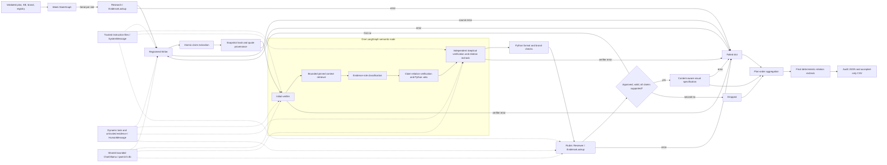
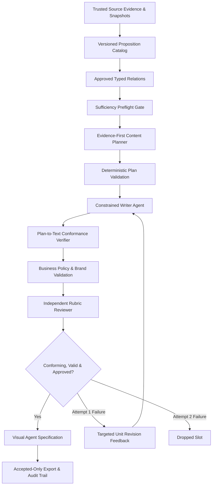
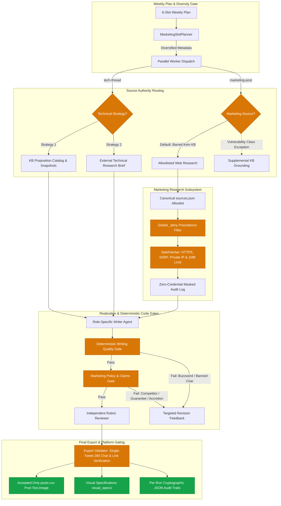

# Architecture

The outer LangGraph `StateGraph` sends one typed `PieceState` per slot. Each piece graph follows explicit node handoffs and conditional routing. Results are sorted back to plan order. A failed worker produces its own failed result; other slots continue. There are at most two content drafts per slot. Transport retries are separate and bounded. The default inference limit is one active Ollama request; local CLI processes also share a file lock at that setting. The graphs may schedule slots concurrently, but that does not imply concurrent model generation.

## Roles and trust boundaries

`ResearchAgent` resolves the focus against the KB through `EvidenceLookup`; an empty focus selects a deterministic KB topic. `WriterAgent` uses a registry-selected instruction file to create a structured `Draft`. `ReviewerAgent` independently scores the result from an editable rubric and also invokes `EvidenceLookup`. These are two real consumers of the shared skill. `SemanticVerifier` independently evaluates each extracted atomic claim against pinned source quotations. The Visual Agent is deterministic and uses the approved draft, topic, verified claims, and evidence to write a content-specific image specification.

For the three LLM components, versioned professional instructions enter a real LangChain `SystemMessage`. Slot assignments, brand rules, rejected draft feedback, source quotations, and other dynamic material enter a JSON `HumanMessage`. The source text is untrusted data. A prompt injection in a quotation can still influence a model, so Python retains the authority to reject failed provenance, invalid citations, unsupported claims, low rubric scores, and formatting errors.

The Reviewer receives concise source quotations, the actual `tweets` array and measured lengths, hard-rule errors, and final atomic verdicts with selected spans. If it rejects despite all its own scores passing and no failed mandatory gate, one bounded reviewer-consistency re-evaluation asks it to correct its score or decision. A second inconsistency fails that slot; Python never changes an adverse judgment into approval. This reviewer response repair is separate from the single allowed content revision and from transport retries.

## Evidence and output flow

Each KB evidence record names an HTTPS source, a local snapshot, its SHA-256 digest, title, type, retrieval date, exact quoted substring and offsets, and claim scope. KB loading checks schema shape; the selected slot checks source file integrity, so a broken source fails that slot while other slots continue. The legacy `excerpt` is a summary, not verbatim proof. The source quote is the admissible technical text. Every public sentence is segmented into atomic propositions with offsets and mapped to candidate evidence IDs. The verifier returns one verdict per proposition, selecting exact numbered source span options when it claims support. Python resolves those options back to the snapshot and rejects unknown or missing spans. A second skeptical pass sees the selected spans and bounded, offset-bearing source windows so it can interpret list headings, antecedents, and conditions. It can still veto; context alone is never proof. Both decisions and exact context offsets are persisted. The two passes now classify each claim's asserted relationship and each selected source relationship. Python records source-role syntax hints and vetoes internally contradictory positives, normative-only root-cause inferences, recommendation-only guarantees, and certainty upgrades. An adverse relationship verdict can trigger the existing single Writer revision; no third draft or forced approval is possible. Export rechecks window hashes, source identity, text, and the final deterministic relation gate for accepted output. A `SUPPORTED` label remains a model judgment; benchmarks and manual inspection measure its fallibility.

The SWC-107 active snapshot is a normalized excerpt of the official Markdown source, with its raw Markdown preserved. This retains the separate remediation bullets that the previous flattened HTML snapshot merged. Sentence extraction masks abbreviations such as `ie.` without changing offsets and treats Markdown bullets as separate exact source spans. The older flattened snapshot remains so diagnostic output from before the correction can still be audited.

The source window records `window_partial` when its offsets cover less than the pinned quotation. A separate `truncated` flag means a requested neighbor did not fit the character or conservative UTF-8-byte budget. The skeptic receives both so it does not infer that ordinary nearby context was lost to a budget limit. New windows carry both flags; older persisted windows without `window_partial` remain readable. A skipped semantic node has no model usage event, so it does not by itself make an otherwise measured run's token metadata incomplete.

`extract`, `provenance`, `semantic`, and `evaluate` each leave attempt records. An accepted result must have complete final claims, all `SUPPORTED` verdicts, no hard errors, approved review scores, and a visual specification. The exporter checks those conditions again before creating a run directory. `claims.json`, `evidence_provenance.json`, `semantic_verification.json`, and `grounding_summary.json` augment the original JSON trail. `posts.csv` has exactly `Post Text,Image` and only accepted content. Its `spec:` image references name written specifications, which must be rendered before any media scheduler can use them.

## Code and model decisions

Python owns input schemas, provenance hashes and exact offsets, claim coverage, objective brand and format rules, conservative relation vetoes, output routing, revision limits, usage aggregation, and export. The local model owns writing, semantic entailment and source-relation judgment, and qualitative rubric scores. Deterministic Research avoids unnecessary inference; the Visual Agent uses a deterministic design policy because it can produce a tailored written specification from the accepted content without another model call. Syntax checks cannot establish general semantic truth or eliminate all causal errors. The claim relation and source relation labels remain auditable model outputs, never automatic proof.

Marketing validation requires a concrete security action, including source-backed imperatives such as checking a return value or isolating a call. It does not require one exact English verb. The same semantic and rubric gates still reject unsupported promises, generic promotion, and invented authority.

## Expansion

The writer registry maps type IDs to instruction files and format settings without central routing changes. An additional post type using the common `Draft` contract needs a registry entry and instructions. A distinct content contract needs a registered adapter and deterministic validator. Fifteen slots use the same `Send` fan-out and plan-order reducer; raise the weekly plan count in input validation and benchmark the queue at the selected Ollama limit. A second social platform needs platform-specific writer guidance and format validation, followed by a separate exporter; this assignment's CSV contract remains fixed.

See [semantic audit](audit/semantic/03_SEMANTIC_VERIFIER_ARCHITECTURE.md), [prompt design](audit/prompt_architecture/02_PROMPT_ARCHITECTURE_DESIGN.md), and the [workflow viewer](audit/visuals/workflow_viewer.html).

---

# Evidence-First V2 Architecture (2026-10-16)

## 1. Paradigm Shift
In V1, unconstrained natural language generation was followed by expensive, fragile post-hoc claim extraction and multi-pass semantic proof. In Evidence-First V2 (`--mode evidence_first_v2`):
- Factual propositions and typed relations are selected and validated **before** text generation.
- The Writer is constrained to realizing pre-approved factual units.
- Conformance verification checks whether realization stays within the approved plan boundaries, replacing combinatorial relation extraction.

## 2. Core V2 Components
1. **Proposition Catalog (`content_pipeline/proposition_catalog.py`):**
   - Stores versioned, evidence-witnessed propositions (`VerifiedProposition`) and typed relations (`TypedRelation`).
   - Closed-world authority: no relation can exist without explicit evidence spans.
2. **Content Planning & Sufficiency Preflight (`content_pipeline/content_planning.py`):**
   - Assesses whether a topic possesses sufficient distinct mechanisms, consequences, and mitigations before model inference.
   - Generates typed `EvidenceFirstPlan`s mapping tweets to specific planned units.
3. **Plan-to-Text Conformance (`content_pipeline/conformance.py`):**
   - Enforces a 10-point verification contract verifying proposition fidelity, scope preservation, absence of unlicensed claims, and causal direction.
   - Employs honest uncertainty verdicts (`CONFORMS`, `UNLICENSED_ASSERTION`, `SCOPE_VIOLATION`, `CONTRADICTS_PLAN`, `INSUFFICIENT_EVIDENCE`, `ABSTAIN`, `VERIFICATION_ERROR`).
4. **Business Policy V1 (`content_pipeline/business_policy.py`):**
   - Enforces deterministic hard policies (source whitelists, allowed topics, platform constraints, prohibited categories, mandatory disclaimers).
   - Injects soft brand preferences (tone, audience, style) into agent guidance.
   - Supports synthetic profiles (`security_audit_firm`, `strict_professional_client`, `creative_tech_brand`).
5. **Targeted Revision Loop:**
   - On attempt 1 failure, passes targeted feedback only to failing units while keeping conforming units stable.
   - Strict 1-revision ceiling prevents runaway inference.

## 3. Trust-Boundary & Authority Enforcement Architecture (Findings F1–F8 Remediation)
Following independent audit of the Evidence-First V2 architecture, trust boundaries were reinforced across catalog, planning, conformance, and export:
1. **Witness Span Integrity (F1, F7):** `validate_catalog_integrity()` recomputes `source_span_options(witness.source_quote)` and strictly asserts byte-exact equality with `witness.spans`, preventing altered or fabricated text. All `TypedRelation.evidence_span_ids` must belong to witnesses supporting the relation's source or target proposition. Source snapshots resolve portably via dynamic project root detection.
2. **Deterministic Modality & Scope Gate (F2, F3, F8):** Conformance verification employs a hard deterministic preflight before model inference:
   - *Modality Preservation:* Rejects escalation from possibility ("sometimes") to frequency ("often", "frequently", "typically", "usually", "always") with `CONTRADICTS_PLAN`.
   - *Universal Scope Veto:* Rejects unqualified universal claims ("all Solidity code", "applies to all", "in every smart contract", "eliminates all risk").
   - *Compiler Version Qualifications:* Enforces historical scope constraints (<0.4.22 for legacy constructors).
3. **Fail-Closed Export Gate (F4):** When `pipeline_mode == "evidence_first_v2"`, missing or incomplete conformance reports immediately raise `ValueError` (zero fallback to legacy claim checks). Exporter asserts that each unit has `verdict == "CONFORMS"`, `passed is True`, and exact tweet text matching.
4. **Plan Authority & Version Binding (F5):** `EvidenceFirstPlan.validate_plan_references()` strictly validates that plan versions match active `catalog_version` and `policy_version`, all proposition IDs belong to the slot topic, and all relation endpoints appear in the plan units. Plan SHA-256 hashes bind plan identity to execution.
5. **Human Approval Enforcement & Quality Thresholds (F6):** When `BusinessPolicy.human_review_requirements.require_human_approval_for_ship = true`, unapproved pieces are routed to `ready_for_human_review.json` and strictly excluded from `posts.csv`. The evaluate node mechanically enforces minimum review scores against configured `QualityThresholds`.

## 4. Final Remediation Architecture (Material Blockers A, B, C)

1. **Topic-Isolated Planner Guidance (Blocker A):**
   - Eliminated hardcoded legacy constructor and initialization prompts from generic technical thread mechanism planning.
   - Writer instructions and unit guidance are dynamically synthesized strictly from assigned proposition IDs, relations, and qualifiers.
   - Conformance checking implements domain-exclusive `topic_signatures` (reentrancy, access control, oracle manipulation) that deterministically veto cross-topic concept imports (e.g., initialization logic in reentrancy) with `UNLICENSED_ASSERTION`.

2. **Bound Authority & Clearance Modes (Blocker B):**
   - Plans dynamically bind active policy ID, policy version, and computed policy hash.
   - `validate_plan_references()` enforces `authorization_mode`: in `publication_eligible` mode, catalog entries must have `APPROVED` status, failing closed on any `REVIEWED_FOR_PILOT` status.
   - In `export.py`, accepted slots re-verify plan authority against active catalog and policy before releasing to `posts.csv`.

3. **Authenticated Human Approval Records (Blocker C):**
   - Replaced unauthenticated boolean flags with `HumanApprovalRecord` data model binding `approver_id`, `approver_role`, `approved_at`, `approved_draft_hash` (SHA-256 of draft tweets), `policy_id`, `policy_version`, and a cryptographic composite `approval_witness` signature.
   - `export.py` independently verifies draft text hash, policy ID, and policy version against the approval record before shipping.
   - The CLI (`cli.py`, `run_week.py`, `run_piece.py`) provides first-class `--policy` and `--authorization-mode` flags for multi-profile enterprise operation.

## 5. Content-Type Specific Structured Contracts & Targeted Revision Mechanics (Closure 01)

To achieve reliable 6/6 content yield while strictly preserving factual and brand gates:
1. **Pydantic Model Schema Constraints:**
   - Defined `MarketingDraft` enforcing `min_length=1, max_length=1` for marketing posts.
   - Defined `TechThreadDraft` enforcing `min_length=5, max_length=10` for technical threads.
   - Passed directly to Ollama's `with_structured_output(..., method="json_schema")`, constraining the decoder grammar to emit exactly the required array item bounds.
2. **Clear Count Instructions:**
   - Writer prompt explicitly distinguishes single tweets from multi-sentence contents. For marketing posts, multiple sentences combining the hazard and actionable review recommendation inside the single 280-character tweet are explicitly permitted.
3. **Targeted Formatting Revision Feedback:**
   - When a count mismatch occurs on attempt 1, the graph provides unambiguous feedback: *"Marketing posts must contain exactly one tweet. Your draft contained {count}. Rewrite the content as one coherent, source-grounded tweet within the platform character limit. Preserve only approved propositions and relations."*
   - Avoids duplicating synthetic conformance mismatch errors, ensuring the model focuses exclusively on consolidating content into a single tweet.

## 6. Semantic Invariant Enforcement & Bounded Grounding Repair (Closure 02)

Following independent audit findings F1 (unsupported financial outcome for DoS topic), F2 (hyperbolic severity and comparative ranking in oracle defenses), and F3 (modality overreach from recommendation to mandate):

1. **Semantic Invariant:**
   - If realized text introduces a novel consequence, severity level, causal link, comparative ranking, or scope beyond the approved unit, it cannot receive `CONFORMS` without an explicit evidence-witnessed proposition or relation.
2. **Deterministic Preflight Guarding:**
   - *Comparative Rankings:* Vetoes claims such as `primary defense`, `sole protection`, or `most critical safeguard` unless explicitly licensed by a proposition.
   - *Hyperbolic Severity:* Vetoes totalizing claims such as `complete subversion`, `significant fund losses`, or `devastating impact` unless quantified in source evidence.
   - *Unlicensed Consequence Domains:* Vetoes financial outcome claims (`draining funds`, `stealing funds`) when unit propositions are restricted to operational failure or denial-of-service (`PROP_SWC113_DOS_CONDITION`).
3. **Structured Conformance Model Contract:**
   - `ModelConformanceDecision` includes an explicit `unsupported_outcomes_or_severity_detected: bool` flag. When true, the verifier is forced to emit `UNLICENSED_ASSERTION`, preventing small LLM judges from rationalizing unlicensed additions as "stylistic" or "logical" extensions.
4. **1-to-1 Unit-to-Proposition Planning:**
   - Technical threads decouple multi-proposition topics (such as SWC-105) into distinct single-proposition units (`EXPOSING_INIT` to U2, `LEGACY_CONSTRUCTOR` to U3, `RESTRICT_WITHDRAWALS` to U4, `OZ_OWNABLE` to U5), eliminating tweet array collision and verifier misalignment.

## 7. Assignment Compliance & Copy-Quality Closure Architecture (Closure 03)

Following independent audit findings F1 (role-specific instructions bypassed in V2), F2 (bypassed marketing action validator in V2), F3 (unapproved link enforcement gap), and F4 (copy defects):

1. **Dual Role-Specific Writer Dispatch (F1):**
   - Maintained unified `EvidenceFirstWriterAgent` implementation while instantiating role-specific configurations in the V2 graph:
     - `tech-thread` config: dynamically loads `instructions/tech-thread.md` (role: smart contract security educator) combined with `instructions/evidence-first-writer.md`.
     - `marketing-post` config: dynamically loads `instructions/marketing-post.md` (role: B2B cybersecurity marketing writer) combined with `instructions/evidence-first-writer.md`.
   - Dynamic prompt generation ensures that any edits to role-specific files on disk immediately alter that role's system prompt without mutating other roles or requiring code changes.
2. **Deterministic Marketing Action Verification (F2):**
   - Centralized `check_marketing_action(text: str) -> bool` to distinguish genuine reader-oriented action invitations (`Review...`, `Inspect...`, `To isolate..., wrap...`, `to prevent this, explicitly verify...`) from passive vulnerability descriptions (`don't check return values`, `fails to verify`).
   - Integrated into V2 `evaluate()` and final export gate in `export.py`. Marketing posts lacking an actionable recommendation fail validation and route to targeted revision.
3. **Deterministic Brand URL Allowlist Enforcement (F3):**
   - Centralized `validate_brand_and_platform(tweets, brand, spec)` to enforce `brand.allowed_links: []`.
   - Rejects unauthorized URLs across single posts and multi-tweet threads during evaluation and fails closed at export.
4. **Copy-Quality and Canonical Proposition Repair (F4):**
   - Updated canonical text for `PROP_SWC105_RESTRICT_WITHDRAWALS` in `catalog.json` to grammatically sound formulation: *"Implement access controls so Ether withdrawals can be initiated only by authorized parties or as specified by the contract."*
   - Neutralized hook guidance in planner and instructions to eliminate causal superlatives ("the core mechanism") in reentrancy content.
   - Enhanced marketing prompt to consistently generate actionable, evidence-backed review recommendations.

---

## 8. SanadSquad V3 Architecture: Source Separation, Marketing Research & Writing Quality

Operating under Directive `SANADSQUAD_V3_ADDITIONAL_REQUIREMENTS_01`, the V3 architecture introduces layered source separation, allowlisted marketing research, deterministic writing quality gates, and marketing guide policy constraints.

### 1. Two-Tier Content & Source Authority Separation
- **`tech-thread` (5–10 tweets):** Focuses on technical education and vulnerability mechanics. Operates under either:
  - **Strategy 1 (Knowledge Base):** Uses curated, checksummed propositions from `kb.json` and catalog snapshots.
  - **Strategy 2 (External Technical Research Brief):** Retains an external technical resource cited by URL with an accompanying structured research brief.
- **`marketing-post` (strictly 1 tweet $\le 280$ chars):** Focuses on firm service offerings and industry context.
  - **KB Isolation Invariant:** Marketing posts are strictly barred from querying `kb.json` by default (`SourceAuthorityError: Access to knowledge_base is forbidden`).
  - **Bounded Exception:** Only under an explicit vulnerability class exception may KB entries be attached as supplemental context (`supp_*`), while primary evidence remains external research.

### 2. Marketing Research Subsystem
- **Canonical Configuration (`sources.json`, `source.json`):** Defines strict domain allowlists across four service lines:
  - `web3-security`: Smart contract audits, SVM/EVM protocol reviews, formal invariant verification.
  - `pentesting`: Protocol infrastructure, cloud IAM, CI/CD pipeline supply chain security, developer access.
  - `agentic-security`: Autonomous agent red teaming, prompt injection defenses, tool authorization boundaries.
  - `agentic-payments`: x402 vs MPP settlement mechanics, autonomous treasury management, spend policy enforcement.
- **Five Structured Source Groups:** `blogs`, `docs`, `production`, `analysis`, `figures`.
- **Global Denylist (`_deny`):** Domains on `_deny` are strictly rejected across all service lines, overriding any allowlist inclusion.
- **Security & SSRF Protection (`SafeFetcher`):**
  - Strictly enforces HTTPS; plaintext HTTP is immediately rejected with HTTP 400.
  - Blocks loopback (`127.0.0.0/8`, `::1`), private IP subnets (`10.0.0.0/8`, `172.16.0.0/12`, `192.168.0.0/16`), link-local/cloud metadata (`169.254.169.254`), and unspecified addresses (`0.0.0.0`).
  - Enforces a 1 MB response payload ceiling and max 3 redirects.
  - Sanitizes HTML into plain text, stripping scripts, styles, and tags.
- **Audit Logging & Credential Masking (`ResearchLogger`):** Every search query and fetch attempt is recorded in `research_log.json`. Sensitive tokens (`api_key=...`, `Bearer ...`) are masked with `[REDACTED]`.

### 3. Marketing Guide Policy & Content Guardrails
- **Platform Length Contract:** Strictly enforces single-tweet marketing copy ($\le 280$ characters).
- **Supported Formats:** Validates 5 single-tweet formats from the Marketing Guide:
  - `short-tip`: One to three sentences. Concrete observation or review habit. Link forbidden.
  - `differentiation`: Medium length. Names a gap contract-only firms leave open and shows how SanadSquad closes it.
  - `service-overview`: Explains what a service line covers and why it matters now.
  - `news-reaction`: Recent event plus SanadSquad technical interpretation. Source link mandatory.
  - `learning-resource`: Highlights an article, doc, or roadmap worth reading with rationale. Source link mandatory.
  - *Future Format:* `marketing-thread` (3–7 tweets) is defined and reserved in schema, but strictly blocked in execution under the current single-tweet contract.
- **Claims Restrictions:**
  - *Competitor Attacks:* Strictly blocks naming or attacking competitors (e.g. CertiK, OpenZeppelin, Trail of Bits, ConsenSys Diligence).
  - *Absolute Guarantees:* Deterministically rejects absolute security guarantees ("100% secure", "hack-proof", "guaranteed vulnerability-free").
  - *Accretion Audit Isolation:* Third-party audit reports (such as the 20 Accretion findings) are strictly isolated as external reference evidence and never claimed as SanadSquad work or client stats. The canonical audit file `audits.json` is strictly maintained as an empty array (`[]`) conforming to `schemas/audits.schema.json`.

### 4. Weekly Diversity Planning Engine (`MarketingSlotPlanner`)
- **Commercial CTA Ceiling:** At most 1 commercial CTA out of 3 marketing posts ($\le 1/3$).
- **Service Line Uniqueness:** Every weekly schedule covers 3 distinct service lines across its 3 marketing posts.
- **Format Variety:** No single format may appear more than twice in a single week.
- **Link Distribution:** Both link-required (`news-reaction` / `learning-resource`) and link-forbidden (`short-tip`) formats must be represented.
- **Topic Fingerprinting:** MD5-based fingerprinting prevents duplicate research angles within the same week.

### 5. Deterministic Human Writing Quality Gates
Machine-enforced code checks (`writing-quality-rules.json` and `content_pipeline/writing_quality.py`) eliminate common LLM stylistic markers:
- **Banned Characters:** Em dash (`—`), separator en dash (`–`), curly quotes (`“ ” ‘ ’`), emojis, unicode obfuscation.
- **14 Banned Buzzwords:** `delve`, `testament`, `tapestry`, `vital`, `crucial`, `beacon`, `game-changer`, `synergy`, `unleash`, `elevate`, `paramount`, `revolutionize`, `cornerstone`, `foster` (detected via word-boundary regex).
- **Negative Parallelisms:** Detects and blocks stylistic clichés (`not just X, but Y`, `not only X, but Y`).
- **Copula Overuse:** Flags drafts dominated by weak linking verbs (`is`, `are`, `was`, `were`).
- **Filler Openings:** Vetoes empty conversational throat-clearing (`in today's world`, `as we all know`, `let's explore`).
- **Rule of Three:** Blocks sentences exhibiting repetitive ternary rhythmic phrasing (`A, B, and C`).
- **Variance & Hedging:** Enforces sentence length standard deviation $\ge 3.0$ and bounds hedging adverb density $\le 0.15$.

### 6. Company Contact Configuration & Deterministic CTA Engine (Directive SANADSQUAD_V3_CONTACT_CTA_CLOSURE_01)
Commercial marketing posts may invite readers to contact SanadSquad for commercial inquiries using approved contact details:
- **Canonical Configuration (`company-contact.json`):** Bound by `schemas/company-contact.schema.json` and parsed by `content_pipeline/contact_config.py`. Enforces strict company name (`SanadSquad`), business email, phone with country code (`+`), optional website, and explicit approval status (`approved: bool`).
- **Contextual CTA Generation (`build_contextual_cta`):** Generates service-line-specific invitations:
  - *Web3 Security:* Reviewing protocol security? Contact SanadSquad to discuss risks.
  - *Web2 Pentesting:* Assessing developer infrastructure risks? Consult SanadSquad.
  - *Agentic Security:* Evaluating agent wallet permissions? Contact SanadSquad.
  - *Agentic Payments:* Integrating agentic payment protocols? Discuss with SanadSquad.
  All CTA separators strictly use clean ASCII (`|` or `,`), never banned unicode dashes (`—`, `–`).
- **Deterministic Contact Validation (`validate_contact_cta`):**
  1. *Approval Verification:* Rejects any contact details if `approved: false` or fields are empty.
  2. *Exact Value Matching:* Any email or phone in text must byte-for-byte match the approved configuration.
  3. *Weekly Frequency Enforcement:* $\le 1$ commercial CTA across 3 weekly marketing posts.
  4. *Single Post Limit:* At most 1 CTA per post.
  5. *Tech Thread Prohibition:* Strictly 0 CTAs or contact details in technical threads.
  6. *Single-Tweet Character Limit:* Complete post must remain $\le 280$ characters post-insertion.
  7. *Non-Evidence Metadata Rule:* Contact information is approved company metadata, never external research evidence or claim support.

### 7. Official Brand Integration & Service Catalog Architecture (Directive SANADSQUAD_V3_OFFICIAL_BRAND_INTEGRATION_01)
To ensure that marketing outputs authentically reflect SanadSquad's official public positioning, the architecture integrates verified information from the official company website (`https://sanadsquad.com/`):

- **Five Official Commercial Services:**
  1. *Blockchain security audits* (`https://sanadsquad.com/services/blockchain-security-audits/`): EVM and non-EVM (Solana/SVM, Sui) manual review of invariants, accounting/rounding, access control, price manipulation, reentrancy, and economic mechanisms; optional fuzzing and formal verification.
  2. *Penetration testing* (`https://sanadsquad.com/services/penetration-testing/`): Real-world simulated attacks against web apps, APIs, blockchain infrastructure, and Web3 off-chain components.
  3. *Agentic security tooling* (`https://sanadsquad.com/services/ai-security-tooling/`): Custom AI security software including protocol-specific detectors, automated PR reviewers, and monitoring agents.
  4. *Agentic payments* (`https://sanadsquad.com/services/agentic-payments/`): Building payment agents for x402 and MPP, MCP server review, facilitator integrations, and payment authorization security.
  5. *Security consulting* (`https://sanadsquad.com/services/consulting/`): Early security design review before implementation, system architecture guidance, and continuous security review.

- **Dual-Layer Commercial-to-Research Mapping:**
  The 5 commercial services map onto the 4 canonical marketing research categories in `sources.json`:
  - `blockchain-security-audits` $\to$ `web3-security`
  - `penetration-testing` $\to$ `pentesting`
  - `agentic-security-tooling` $\to$ `agentic-security`
  - `agentic-payments` $\to$ `agentic-payments`
  - `security-consulting` $\to$ `web3-security` (or cross-cutting allowlists)

- **Verified Public Business Contacts & Fail-Closed Approval:**
  - Business email: `frank@sanadsquad.com`
  - Contact form: `https://sanadsquad.com/contact/`
  - Telegram: `@castle_chain`
  - X (Twitter): `@SanadSquad`
  - Phone: `None` (verified absent on website). Fictional phone numbers (`+1-555-0199`) and fictional emails are strictly prohibited. The recruitment email (`career@sanadsquad.com`) is strictly isolated from commercial inquiries.
  - Fail-closed approval: `company-contact.json` is maintained with `approved: false` (`AWAITING_OWNER_APPROVAL`), ensuring that unapproved contact data does not emit commercial CTAs.

- **Confidentiality & Epistemic Boundaries:**
  - Private audit records are excluded: `audits.json` remains strictly empty (`[]`). Publicly displayed website audit counts or success metrics are barred from marketing claims without explicit marketing authorization.
  - Third-party technical evidence (e.g. OWASP, Coinbase, Solana) provides technical grounding for risk, not proof of SanadSquad client work.
