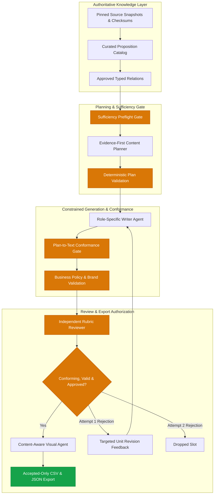

# SanadSquad — Evidence-First V2 Content Pipeline

> **Autonomous, source-grounded multi-agent content generation for smart contract security.**  
> Powered by local Ollama (`qwen3.5:4b`), LangGraph, and a fail-closed Evidence-First architecture.

[](#verification--test-suite)
[](ARCHITECTURE.md)
[](#docker-quick-start-offline-single-image)
[-lightgrey.svg)](#technology-stack)
[](docs/ENGINEERING_EVOLUTION_AND_EVALUATION.md)

---

## 1. Executive Summary & Reviewer Quick Guide

SanadSquad generates a weekly six-slot content schedule for an enterprise smart contract security auditing firm (three in-depth technical threads and three actionable marketing posts). 

Unlike conventional pipelines that generate unconstrained prose and attempt fragile post-hoc fact checking, SanadSquad operates on an **Evidence-First V2** architecture: factual propositions and typed relations are selected, validated, and bounded **before** natural language generation. Conformance verification then strictly enforces that generated copy does not exceed the approved factual plan.

### Key Operational Metrics (Final Frozen Editorial Release)
- **Content Yield:** **6 planned, 6 shipped, 0 dropped, 0 failed** (100% acceptance yield, 0 drops).
- **Native Inference Runtime:** **618.972 seconds (~10.3 minutes)** on workstation CPU (peak concurrency strictly clamped to 1).
- **Offline Docker Runtime:** **1,144.168 seconds (~19.07 minutes)** on pure CPU inside isolated container (`--network none`).
- **Token Efficiency:** **36,270 prompt tokens, 2,492 completion tokens** (38,762 total tokens).
- **Cost:** **$0.00 external API charges** (100% local Ollama inference with zero network dependency).
- **Deliverables:** Validated CSV ([output/final-editorial-release/posts.csv](output/final-editorial-release/posts.csv) with exact `Post Text,Image` columns), six visual specifications ([output/final-editorial-release/visual_specs/](output/final-editorial-release/visual_specs/)), and full cryptographic audit trails.

---

## 2. Evidence-First V2 Architecture



### Why Evidence-First V2 Replaced V1
1. **The V1 Post-Hoc Failure Mode:** In V1, the LLM generated unrestricted text, after which a verifier extracted propositions and matched them against source text. In holdout evaluations, V1 suffered a severe **28/34 (82.35%) recall failure**, frequently hallucinating causal links, inverting recommendations into root causes, or expanding narrow scopes ("low-level calls") into universal overclaims ("all external calls").
2. **Computational Overhead:** V1 consumed over 250,000 tokens and 35+ minutes per week due to multi-pass verifier loops and cascading draft rejections.
3. **The V2 Solution:** Factual units (`VerifiedProposition`) and relations (`TypedRelation`) are curated in a closed-world catalog (`knowledge/evidence_first_v2/catalog.json`). The planner constructs an immutable `EvidenceFirstPlan`, and the writer realizator is strictly bound to that plan. Conformance verification checks fidelity rather than attempting open-domain fact discovery.

For the complete architectural evolution and negative benchmark data, see:
- [Engineering Evolution and Final Evaluation](docs/ENGINEERING_EVOLUTION_AND_EVALUATION.md)
- [Detailed System Architecture](ARCHITECTURE.md)
- [Legacy V1 Architecture & Post-Mortem](docs/history/LEGACY_V1_ARCHITECTURE.md)

---

## 3. Quick Start — Offline Docker (Recommended)

A self-contained, offline container image (`ghcr.io/shadymayez/sanad-squad-task1:v2-final`) bundles Python 3.12, locked dependencies, the embedded Ollama daemon, and pre-baked `qwen3.5:4b` model weights. It runs completely offline with `--network none` and requires no host-installed Ollama or GPU drivers.

### A. Pull Public Image from GHCR
Reviewers can pull the verified image directly without authentication:
```bash
# Using Docker:
docker pull ghcr.io/shadymayez/sanad-squad-task1:v2-final

# Or using Podman:
podman pull ghcr.io/shadymayez/sanad-squad-task1:v2-final
```

### B. Offline Execution (Strict `--network none`)
To execute the pipeline strictly offline with a host output directory:
```bash
# Prepare host output directory
mkdir -p output/docker-eval

# Using Podman (rootless, Fedora / RHEL compatible with :Z and --userns=keep-id):
podman run --rm --network none \
  --userns=keep-id \
  -v "$(pwd)/output/docker-eval":/app/output:Z \
  ghcr.io/shadymayez/sanad-squad-task1:v2-final \
  --plan /app/plan.json \
  --mode evidence_first_v2 \
  --authorization-mode publication_eligible \
  --output /app/output/v2-week

# Or using Docker:
docker run --rm --network none \
  -v "$(pwd)/output/docker-eval":/app/output \
  ghcr.io/shadymayez/sanad-squad-task1:v2-final \
  --plan /app/plan.json \
  --mode evidence_first_v2 \
  --authorization-mode publication_eligible \
  --output /app/output/v2-week

# Inspect generated deliverables
cat output/docker-eval/v2-week/posts.csv
cat output/docker-eval/v2-week/summary.json
```

### C. Run Regression Tests Inside Container (Offline)
```bash
# Verify 170 tests offline with zero network connectivity:
podman run --rm --network none ghcr.io/shadymayez/sanad-squad-task1:v2-final pytest -q
# Or via Docker:
docker run --rm --network none ghcr.io/shadymayez/sanad-squad-task1:v2-final pytest -q
```

### D. Rebuilding the Image from a Fresh Clone
A clean clone can rebuild the self-contained image using the version-pinned, checksum-verified bootstrap script:
```bash
# 1. Clone repository
git clone https://github.com/ShadyMayez/Sanad-Squad-task1.git
cd Sanad-Squad-task1

# 2. Bootstrap and verify version-pinned Ollama binaries, libraries, and model blobs
./docker/bootstrap.sh

# 3. Build image
docker build -t ghcr.io/shadymayez/sanad-squad-task1:v2-final .
```

### E. Hardware Requirements & Architecture
- **Supported Architecture:** Linux `x86_64` (AMD64).
- **CPU Requirements:** Minimum 4 physical cores, 8 GB RAM (16 GB recommended).
- **Runtime Performance:** ~10.3 minutes (native workstation) / ~19.07 minutes (containerized CPU) for a complete 6-slot weekly run.
- **Output Volume Configuration:** Bind-mount to `/app/output`. On SELinux-enforcing distributions (Fedora, RHEL), use `:Z` and `--userns=keep-id`.

For automated container offline validation, execute:
```bash
bash docker/verify_offline_image.sh ghcr.io/shadymayez/sanad-squad-task1:v2-final
```

---

## 4. Quick Start — Native Python

### Prerequisites
- Linux / macOS with Python 3.12
- Local Ollama installed with `qwen3.5:4b`:
  ```bash
  ollama pull qwen3.5:4b
  ollama serve
  ```

### Installation & Run
```bash
# 1. Set up virtual environment and install dependencies
python3.12 -m venv .venv
source .venv/bin/activate
pip install -r requirements.txt

# 2. Execute full 6-slot Evidence-First V2 weekly run (Default Mode)
python run_week.py --plan plan.json --mode evidence_first_v2 --authorization-mode publication_eligible --output output/v2-week-run

# 3. Execute a standalone piece
python run_piece.py --type tech-thread --topic "reentrancy" --output output/standalone-thread
python run_piece.py --type marketing-post --topic "unchecked call return value" --output output/standalone-post
```

---

## 5. Verification & Test Suite

The repository contains 170 active unit, regression, adversarial, and audit tests verifying deterministic schemas, graph routing, invariant enforcement, brand rules, and adversarial resistance:

```bash
.venv/bin/pytest -v
```

```text
============================= test session starts ==============================
collected 170 items
tests/prompt_quality/test_prompt_contracts.py .........                  [  5%]
tests/test_context_quality.py .................                          [ 15%]
tests/test_evidence_first_v2.py ........................................ [ 38%]
.............                                                            [ 46%]
tests/test_pipeline.py .........................                         [ 61%]
tests/test_relation_integrity.py ...............................         [ 79%]
tests/test_semantic_grounding.py ............                            [ 86%]
audit/tests/test_independent_audit.py .......................            [100%]
============================= 170 passed in 1.84s ==============================
```

---

## 6. Project Structure

```text
sanadsquad/
├── README.md                           # Navigable project overview & quickstart
├── ARCHITECTURE.md                     # Comprehensive architecture and trust model
├── LIMITATIONS.md                      # Scientific, model, and operational limitations
├── ACCEPTANCE_MATRIX.md                # Full compliance matrix against requirements
├── Dockerfile                          # Self-contained offline single-image definition
├── .dockerignore                       # Clean build context exclusion rules
├── .gitignore                          # Worktree protection and artifact rules
├── pyproject.toml / requirements.txt   # Locked Python package specifications
├── run_week.py                         # Primary 6-slot orchestration entrypoint
├── run_piece.py                        # Standalone piece generation entrypoint
├── brand-voice.md                      # Editable brand rules, forbidden terms, links
├── kb.json                             # Pinned vulnerability knowledge base
├── plan.json                           # 6-slot weekly assignment content plan
├── content-types.json                  # Content type registry
├── content_pipeline/                   # Core multi-agent LangGraph system
│   ├── graph.py                        # StateGraph definition and node routing
│   ├── proposition_catalog.py          # Evidence-backed proposition catalog
│   ├── content_planning.py             # Sufficiency preflight & unit planning
│   ├── conformance.py                  # Plan-to-text conformance verification
│   ├── business_policy.py              # Brand & business policy enforcement
│   ├── agents.py                       # Writer, Reviewer, and Visual agents
│   ├── validation.py                   # Hard format, brand, and length checks
│   └── export.py                       # Fail-closed CSV and audit trail exporter
├── knowledge/evidence_first_v2/        # Curated catalog and policy templates
├── source_snapshots/                   # Authoritative vulnerability sources & licenses
├── instructions/                       # Separate role instructions (tech, marketing, reviewer)
├── skills/                             # Shared agent skills (evidence lookup)
├── schemas/                            # JSON schema contracts for all artifacts
├── tests/                              # Unit, regression, and prompt tests (147 tests)
├── audit/tests/                        # Independent adversarial audit tests (23 tests)
├── output/
│   ├── final-v2-sample/                # CANONICAL REVIEWED RUN (6/6 accepted, CSV, specs)
│   └── sample-week/                    # Historical baseline run for comparison
├── docs/
│   ├── ENGINEERING_EVOLUTION_AND_EVALUATION.md  # Integrated independent audit report
│   ├── SECURITY_AND_TRUST_BOUNDARIES.md         # Threat model & cryptographic records
│   ├── REPRODUCIBILITY.md                       # Deterministic vs stochastic reproducibility
│   ├── history/                                 # Historical V1 architecture & archive index
│   └── release/                                 # Forensic inventories & release acceptance
└── docker/
    ├── entrypoint.sh                   # In-container Ollama supervisor & CLI launcher
    └── verify_offline_image.sh         # Automated --network none test script
```

---

## 7. Canonical Release Sample (`output/final-editorial-release/`)

The active repository preserves the final frozen release sample generated under Directive `SANADSQUAD_V2_FINAL_EDITORIAL_AND_DOCKER_RELEASE_01`:
- **Location:** [output/final-editorial-release/](output/final-editorial-release/)
- **Editorial Upgrades:** Access control grammar repaired (*"Implement access controls so only authorized parties can initiate withdrawals per contract requirements"*), qualified factual certainty (*"To reduce this impact..."*, *"To mitigate this risk..."*), and improved technical usefulness for reentrancy mechanisms.
- **`posts.csv`:** Exact `Post Text,Image` columns; 6 accepted content rows (three 5-tweet threads, three 1-tweet marketing posts).
- **`visual_specs/`:** All 6 referenced written specifications (`post_1.md` through `thread_3.md`).
- **Audit Trails:** Complete `accepted_content.json`, `claims.json`, `evidence_provenance.json`, `semantic_verification.json`, `review_report.json`, and `summary.json`.

*(The previous baseline run under [output/final-v2-sample/](output/final-v2-sample/) is retained for independent audit rollback history).*

---

## 8. Two-Stage Review & Deterministic vs. Stochastic Boundaries

When evaluating SanadSquad output, senior reviewers must recognize the fundamental boundary between software contracts and neural generation:
1. **Deterministic Software Contracts:** Graph routing, slot isolation, schema validation, brand word bans, length clamping, plan-to-catalog version binding, and CSV formatting are **100% deterministic and machine-verified**.
2. **Stochastic Model Realization:** Fresh executions on small language models (`qwen3.5:4b`) are subject to temperature and hardware quantization differences. While deterministic conformance guards veto unsupported causal leaps and scope overclaims, **passing automated checks is an audit aid, not mathematical proof of semantic truth**. Human editorial sign-off remains mandatory before public deployment.

See [docs/REPRODUCIBILITY.md](docs/REPRODUCIBILITY.md) and [LIMITATIONS.md](LIMITATIONS.md) for complete details.
