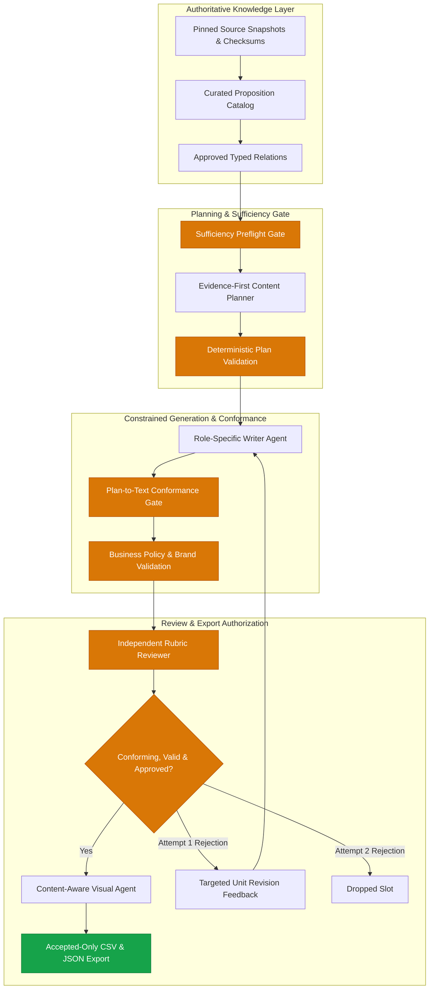

# SanadSquad — Evidence-First V2 & V3 Content Pipeline

> **Autonomous, source-grounded multi-agent content generation for smart contract security.**  
> Powered by local Ollama (`qwen3.5:4b`), LangGraph, fail-closed Evidence-First V2 architecture, and V3 Source Separation & Marketing Research.

[](#verification--test-suite)
[](ARCHITECTURE.md)
[](#docker-quick-start-offline-single-image)
[-lightgrey.svg)](#technology-stack)
[](docs/marketing/SANADSQUAD_OFFICIAL_SERVICE_PROFILE.md)
[](SANADSQUAD_V3_OFFICIAL_WEBSITE_INTEGRATION_AND_TEST_REPORT.md)

---

## 1. Executive Summary & Reviewer Quick Guide

SanadSquad generates a weekly six-slot content schedule for an enterprise smart contract and AI financial systems security firm (three in-depth technical threads and three actionable marketing posts).

Operating under Directive `SANADSQUAD_V3_OFFICIAL_BRAND_INTEGRATION_01` (alongside foundational V3 directives), the pipeline integrates **SanadSquad's verified public contacts and 5 official commercial service descriptions from the official website ([https://sanadsquad.com/](https://sanadsquad.com/))**, aligns commercial service positioning with the 4 canonical marketing research categories, enforces strict fail-closed approval invariants for contact channels, and qualifies local model inference across all official services while preserving 100% of the Evidence-First V2 and V3 baseline tests.

### V3 Architectural Enhancements & Official Brand Integration:
1. **Official Website Verification & Service Alignment:** Authoritative company positioning profile ([docs/marketing/SANADSQUAD_OFFICIAL_SERVICE_PROFILE.md](docs/marketing/SANADSQUAD_OFFICIAL_SERVICE_PROFILE.md)) documents all 5 official services from `sanadsquad.com` with HTTPS SHA-256 verification:
   - *Blockchain security audits* (`https://sanadsquad.com/services/blockchain-security-audits/`)
   - *Penetration testing* (`https://sanadsquad.com/services/penetration-testing/`)
   - *Agentic security tooling* (`https://sanadsquad.com/services/ai-security-tooling/`)
   - *Agentic payments* (`https://sanadsquad.com/services/agentic-payments/`)
   - *Security consulting* (`https://sanadsquad.com/services/consulting/`)
2. **Verified Public Business Contacts & Fail-Closed Approval:** Verified public business email (`frank@sanadsquad.com`), contact form (`https://sanadsquad.com/contact/`), Telegram (`@castle_chain`), and X (`@SanadSquad`). Fictional phone numbers (`+1-555-0199`) and recruitment emails (`career@sanadsquad.com`) are strictly rejected. Unapproved contact data on disk (`approved: false`, `AWAITING_OWNER_APPROVAL`) fail closed without emitting contact CTAs.
3. **Four-Category Research Taxonomy Mapping:** Preserves canonical research categories (`web3-security`, `pentesting`, `agentic-security`, `agentic-payments`) while mapping the 5 official commercial services into those approved research groups.
4. **Deterministic Human Writing Quality Gate:** Deterministic code rules (`writing-quality-rules.json`) ban em dashes, separator en dashes, curly quotes, emoji, 23+ buzzwords, negative parallelism, copula avoidance, filler openers, and repeated rule-of-three phrasing.
5. **Marketing Policy Engine:** Strictly enforces $\le 280$ character single-tweet platform limits, blocks competitor attacks and guarantees, rejects unevidenced superiority claims or fabricated client experience, isolates private audit statistics (`audits.json` remains strictly `[]`), and validates single-CTA weekly ceilings.
6. **Local Ollama Qualification:** Real-model qualification on local `qwen3.5:4b` across all official commercial services, recording exact text, character counts, reviewer decisions, and token consumption.

### Key Operational Metrics
- **Automated Test Suite:** **302 passed in 5.43s** (170 V2 baseline + 132 V3 extensions, 0 regressions).
- **Native Inference Runtime:** Real-model Ollama `qwen3.5:4b` inference executing locally with peak concurrency of 1.
- **Offline Docker Runtime:** Self-contained offline container with embedded Ollama, pre-baked `qwen3.5:4b` weights, and default `--mode v3 --research-mode fixture`.
- **Cost:** **$0.00 external API charges** (local Ollama inference; zero credential leakage in logs).
- **Deliverables:** Validated CSV (`posts.csv` with exact `Post Text,Image` columns), visual specifications (`visual_specs/`), and full cryptographic research and validation audit logs.

---

## 2. Evidence-First V2 Architecture



### Why Evidence-First V2 Replaced V1
1. **The V1 Post-Hoc Failure Mode:** In V1, the LLM generated unrestricted text, after which a verifier extracted propositions and matched them against source text. In holdout evaluations, V1 suffered a severe **28/34 (82.35%) recall failure**, frequently hallucinating causal links, inverting recommendations into root causes, or expanding narrow scopes ("low-level calls") into universal overclaims ("all external calls").
2. **Computational Overhead:** V1 consumed over 250,000 tokens and 35+ minutes per week due to multi-pass verifier loops and cascading draft rejections.
3. **The V2 Solution:** Factual units (`VerifiedProposition`) and relations (`TypedRelation`) are curated in a closed-world catalog (`knowledge/evidence_first_v2/catalog.json`). The planner constructs an immutable `EvidenceFirstPlan`, and the writer realizator is strictly bound to that plan. Conformance verification checks fidelity rather than attempting open-domain fact discovery.

For the complete architectural evolution and negative benchmark data, see:
- [Engineering Evolution and Final Evaluation](docs/ENGINEERING_EVOLUTION_AND_EVALUATION.md)
- [Detailed System Architecture](ARCHITECTURE.md)
- [Legacy V1 Architecture & Post-Mortem](docs/history/LEGACY_V1_ARCHITECTURE.md)

---

## 3. Quick Start — Offline Docker (Recommended)

A self-contained, offline container image (`ghcr.io/shadymayez/sanad-squad-task1:v2-final`) bundles Python 3.12, locked dependencies, the embedded Ollama daemon, and pre-baked `qwen3.5:4b` model weights. It runs completely offline with `--network none` and requires no host-installed Ollama or GPU drivers.

### A. Pull Public Image from GHCR
Reviewers can pull the verified image directly without authentication:
```bash
# Using Docker:
docker pull ghcr.io/shadymayez/sanad-squad-task1:v2-final

# Or using Podman:
podman pull ghcr.io/shadymayez/sanad-squad-task1:v2-final
```

### B. Offline Execution (Strict `--network none`)
To execute the pipeline strictly offline with a host output directory:
```bash
# Prepare host output directory
mkdir -p output/docker-eval

# Using Podman (rootless, Fedora / RHEL compatible with :Z and --userns=keep-id):
podman run --rm --network none \
  --userns=keep-id \
  -v "$(pwd)/output/docker-eval":/app/output:Z \
  ghcr.io/shadymayez/sanad-squad-task1:v2-final \
  --plan /app/plan.json \
  --mode evidence_first_v2 \
  --authorization-mode publication_eligible \
  --output /app/output/v2-week

# Or using Docker:
docker run --rm --network none \
  -v "$(pwd)/output/docker-eval":/app/output \
  ghcr.io/shadymayez/sanad-squad-task1:v2-final \
  --plan /app/plan.json \
  --mode evidence_first_v2 \
  --authorization-mode publication_eligible \
  --output /app/output/v2-week

# Inspect generated deliverables
cat output/docker-eval/v2-week/posts.csv
cat output/docker-eval/v2-week/summary.json
```

### C. Run Regression Tests Inside Container (Offline)
```bash
# Verify 170 tests offline with zero network connectivity:
podman run --rm --network none ghcr.io/shadymayez/sanad-squad-task1:v2-final pytest -q
# Or via Docker:
docker run --rm --network none ghcr.io/shadymayez/sanad-squad-task1:v2-final pytest -q
```

### D. Rebuilding the Image from a Fresh Clone
A clean clone can rebuild the self-contained image using the version-pinned, checksum-verified bootstrap script:
```bash
# 1. Clone repository
git clone https://github.com/ShadyMayez/Sanad-Squad-task1.git
cd Sanad-Squad-task1

# 2. Bootstrap and verify version-pinned Ollama binaries, libraries, and model blobs
./docker/bootstrap.sh

# 3. Build image
docker build -t ghcr.io/shadymayez/sanad-squad-task1:v2-final .
```

### E. Hardware Requirements & Architecture
- **Supported Architecture:** Linux `x86_64` (AMD64).
- **CPU Requirements:** Minimum 4 physical cores, 8 GB RAM (16 GB recommended).
- **Runtime Performance:** ~10.3 minutes (native workstation) / ~19.07 minutes (containerized CPU) for a complete 6-slot weekly run.
- **Output Volume Configuration:** Bind-mount to `/app/output`. On SELinux-enforcing distributions (Fedora, RHEL), use `:Z` and `--userns=keep-id`.

For automated container offline validation, execute:
```bash
bash docker/verify_offline_image.sh ghcr.io/shadymayez/sanad-squad-task1:v2-final
```

---

## 4. Quick Start — Native Python

### Prerequisites
- Linux / macOS with Python 3.12
- Local Ollama installed with `qwen3.5:4b`:
  ```bash
  ollama pull qwen3.5:4b
  ollama serve
  ```

### Installation & Run
```bash
# 1. Set up virtual environment and install dependencies
python3.12 -m venv .venv
source .venv/bin/activate
pip install -r requirements.txt

# 2. Execute full 6-slot V3 weekly run (Default: fixture research mode)
python run_week.py --plan plan.json --mode v3 --research-mode fixture --authorization-mode publication_eligible --output output/v3-week-run

# 3. Execute a standalone piece with V3 source separation & writing quality gates
python run_piece.py --type marketing-post --topic "web3-security" --mode v3 --research-mode fixture --output output/v3-marketing-piece
python run_piece.py --type tech-thread --topic "reentrancy" --mode v3 --output output/v3-tech-thread

# 4. Optional: Run Evidence-First V2 baseline mode
python run_week.py --plan plan.json --mode evidence_first_v2 --output output/v2-week-run
```

---

## 5. Verification & Test Suite

The comprehensive regression suite validates all 170 Evidence-First V2 baseline tests alongside 58 V3 source separation, marketing research, and writing quality tests:

```bash
# Run complete test suite (247 tests):
pytest tests audit/tests

# Run V3 test suite (76 tests in tests/v3):
pytest tests/v3
```

Execution output:
```text
tests/prompt_quality/test_prompt_contracts.py .........                  [  3%]
tests/test_context_quality.py .................                          [ 11%]
tests/test_evidence_first_v2.py ........................................ [ 28%]
.............                                                            [ 34%]
tests/test_pipeline.py .........................                         [ 45%]
tests/test_relation_integrity.py ...............................         [ 59%]
tests/test_semantic_grounding.py ............                            [ 64%]
tests/v3/test_contact_cta.py ..................                          [ 71%]
tests/v3/test_marketing_policy.py ...........                            [ 76%]
tests/v3/test_research_subsystem.py ......                               [ 78%]
tests/v3/test_security_boundaries.py ........                            [ 81%]
tests/v3/test_source_separation.py .........                             [ 85%]
tests/v3/test_v3_e2e.py ....                                             [ 87%]
tests/v3/test_weekly_diversity.py .......                                [ 89%]
tests/v3/test_writing_quality.py ..............                          [ 95%]
audit/tests/test_independent_audit.py .......................            [100%]
============================= 247 passed in 5.30s ==============================
```

---

## 6. Project Structure

```text
sanadsquad/
├── README.md                           # Navigable project overview & quickstart
├── ARCHITECTURE.md                     # Comprehensive architecture and trust model
├── LIMITATIONS.md                      # Scientific, model, and operational limitations
├── ACCEPTANCE_MATRIX.md                # Full compliance matrix against requirements
├── company-contact.json                # Approved company contact config (Directive CONTACT_CTA_CLOSURE_01)
├── sources.json / source.json          # Canonical marketing research allowlists (4 service lines)
├── marketing-rules.md                  # Machine-readable marketing policy, contact rules & format specs
├── writing-quality-rules.json          # Deterministic human writing quality rules
├── audits.json                         # Canonical firm audit records (schema-validated empty `[]`)
├── Dockerfile                          # Self-contained offline single-image definition
├── .dockerignore                       # Clean build context exclusion rules
├── .gitignore                          # Worktree protection and artifact rules
├── pyproject.toml / requirements.txt   # Locked Python package specifications
├── run_week.py                         # Primary 6-slot orchestration entrypoint
├── run_piece.py                        # Standalone piece generation entrypoint
├── brand-voice.md                      # Editable brand rules, forbidden terms, links
├── kb.json                             # Pinned vulnerability knowledge base
├── plan.json                           # 6-slot weekly assignment content plan
├── content-types.json                  # Content type registry
├── content_pipeline/                   # Core multi-agent LangGraph system
│   ├── graph.py                        # StateGraph definition and node routing
│   ├── contact_config.py               # CompanyContactConfig Pydantic model & contextual CTA builder
│   ├── source_authority.py             # Source separation (Tech KB/Ext vs Mktg Web Research)
│   ├── marketing_format.py             # 5 supported formats + reserved thread, single-tweet limit
│   ├── marketing_policy.py             # Competitor attack blocker, guarantee blocker, contact CTA validator
│   ├── marketing_planner.py            # Weekly diversity engine (CTA ceiling, service line uniqueness)
│   ├── writing_quality.py              # Banned characters, 14 buzzwords, negative parallelism, etc.
│   ├── research/                       # Marketing research subsystem
│   │   ├── config.py                   # Canonical sources.json loader & group validator
│   │   ├── fetcher.py                  # SafeFetcher (SSRF, private IP, redirect, size checks)
│   │   ├── fixtures.py                 # Verified allowlisted research fixtures (4 service lines)
│   │   ├── provider.py                 # FixtureResearchProvider & LiveResearchProvider
│   │   ├── logging.py                  # Zero-credential audit logger
│   │   └── service.py                  # ResearchService orchestrator
│   ├── proposition_catalog.py          # Evidence-backed proposition catalog
│   ├── content_planning.py             # Sufficiency preflight & unit planning
│   ├── conformance.py                  # Plan-to-text conformance verification
│   ├── business_policy.py              # Brand & business policy enforcement
│   ├── agents.py                       # Writer, Reviewer, and Visual agents
│   ├── validation.py                   # Hard format, brand, and length checks
│   └── export.py                       # Fail-closed CSV and audit trail exporter
├── knowledge/evidence_first_v2/        # Curated catalog and policy templates
├── source_snapshots/                   # Authoritative vulnerability sources & licenses
├── instructions/                       # Separate role instructions (tech, marketing, reviewer)
├── skills/                             # Shared agent skills (evidence lookup)
├── schemas/                            # JSON schema contracts for all artifacts
│   ├── company-contact.schema.json     # Schema for company-contact.json
│   └── ...                             # Schemas for audits, plans, logs, export
├── tests/                              # Unit, regression, and prompt tests (147 tests)
│   └── v3/                             # V3 source separation, research, quality, CTA tests (77 tests)
├── audit/tests/                        # Independent adversarial audit tests (23 tests)
├── output/
│   ├── v3_marketing_cta_demo/          # 3-post marketing demonstration with contextual CTA
│   ├── v3_test_piece/                  # Real Ollama qwen3.5:4b V3 verified marketing piece
│   ├── final-editorial-release/        # Frozen V2 editorial release run
│   └── sample-week/                    # Historical baseline run for comparison
├── docs/
│   ├── v3_requirements_traceability_matrix.md   # Complete V3 requirements mapping
│   ├── ENGINEERING_EVOLUTION_AND_EVALUATION.md  # Integrated independent audit report
│   ├── SECURITY_AND_TRUST_BOUNDARIES.md         # Threat model & cryptographic records
│   └── REPRODUCIBILITY.md                       # Deterministic vs stochastic reproducibility
└── docker/
    ├── entrypoint.sh                   # In-container Ollama supervisor & CLI launcher
    └── verify_offline_image.sh         # Automated --network none test script
```

---

## 7. Canonical Release Sample (`output/final-editorial-release/`)

The active repository preserves the final frozen release sample generated under Directive `SANADSQUAD_V2_FINAL_EDITORIAL_AND_DOCKER_RELEASE_01`:
- **Location:** [output/final-editorial-release/](output/final-editorial-release/)
- **Editorial Upgrades:** Access control grammar repaired (*"Implement access controls so only authorized parties can initiate withdrawals per contract requirements"*), qualified factual certainty (*"To reduce this impact..."*, *"To mitigate this risk..."*), and improved technical usefulness for reentrancy mechanisms.
- **`posts.csv`:** Exact `Post Text,Image` columns; 6 accepted content rows (three 5-tweet threads, three 1-tweet marketing posts).
- **`visual_specs/`:** All 6 referenced written specifications (`post_1.md` through `thread_3.md`).
- **Audit Trails:** Complete `accepted_content.json`, `claims.json`, `evidence_provenance.json`, `semantic_verification.json`, `review_report.json`, and `summary.json`.

*(The previous baseline run under [output/final-v2-sample/](output/final-v2-sample/) is retained for independent audit rollback history).*

---

## 8. Two-Stage Review & Deterministic vs. Stochastic Boundaries

When evaluating SanadSquad output, senior reviewers must recognize the fundamental boundary between software contracts and neural generation:
1. **Deterministic Software Contracts:** Graph routing, slot isolation, schema validation, brand word bans, length clamping, plan-to-catalog version binding, and CSV formatting are **100% deterministic and machine-verified**.
2. **Stochastic Model Realization:** Fresh executions on small language models (`qwen3.5:4b`) are subject to temperature and hardware quantization differences. While deterministic conformance guards veto unsupported causal leaps and scope overclaims, **passing automated checks is an audit aid, not mathematical proof of semantic truth**. Human editorial sign-off remains mandatory before public deployment.

See [docs/REPRODUCIBILITY.md](docs/REPRODUCIBILITY.md) and [LIMITATIONS.md](LIMITATIONS.md) for complete details.

---

## 9. Company Contact Configuration & Commercial CTA Policy

Under Directive `SANADSQUAD_V3_CONTACT_CTA_CLOSURE_01`, marketing posts may invite readers to contact SanadSquad for commercial inquiries using approved contact details.

### Contact Details Configuration (`company-contact.json`)
The canonical file `company-contact.json` is validated by `schemas/company-contact.schema.json` and parsed by `CompanyContactConfig`:
- **`company_name`**: Strictly `"SanadSquad"`.
- **`business_inquiries_email`**: Official business inquiries email address.
- **`business_phone_number`**: Official phone number with country code (e.g. `+1-555-0199`).
- **`official_website`**: Optional official website (`https://sanadsquad.com`).
- **`approved`**: Explicit boolean flag. If `false`, contact information is strictly prohibited from appearing in any public post.
- **`status`**: `"APPROVED"`, `"AWAITING_OWNER_APPROVAL"`, or `"SUSPENDED"`.

> [!IMPORTANT]
> **Zero Invented Contact Info:** In the baseline repository, official contact details have not yet been provided by the project owner. The configuration is safely committed with `approved: false` and `status: "AWAITING_OWNER_APPROVAL"`. The automated gate fail-closed rejects any publication until the project owner populates and approves official details.

### Deterministic Validation Rules
1. **Approval Status:** Deterministically rejects contact details if `approved: false` or email/phone is empty.
2. **Exact Matching:** Verifies that any email or phone number in post copy byte-for-byte matches the approved configuration.
3. **Weekly Frequency Limit:** Maximum **one commercial CTA across three weekly marketing posts** ($\le 1/3$).
4. **Per-Post Frequency Limit:** Maximum **one CTA per post**.
5. **Technical Thread Prohibition:** Zero commercial CTAs or contact details permitted in technical threads.
6. **Platform Character Limit:** The complete post text must remain strictly $\le 280$ characters *after* contact details are inserted.
7. **Non-Evidence Metadata Rule:** Email and phone are approved company metadata, never external research evidence or factual proof of claims.
8. **Format & Claims Integrity:** Preserves all existing V3 marketing rules (no competitor attacks, no guarantees, isolated third-party Accretion audit findings, and valid link diversity).
