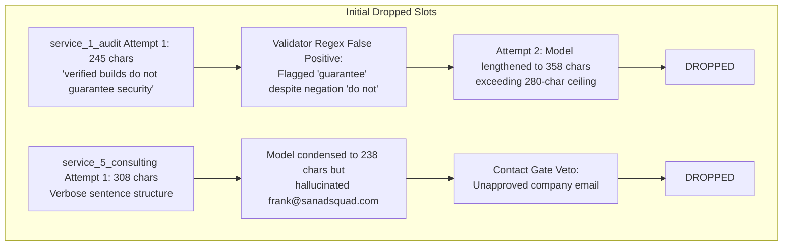
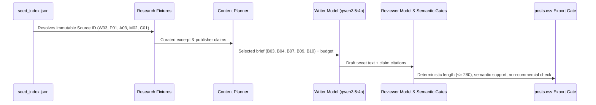

# SANADSQUAD V3 — Knowledge Acceptance Recovery Report

**Directive:** `SANADSQUAD_V3_KNOWLEDGE_ACCEPTANCE_RECOVERY_03`  
**Repository:** `/home/shady/sandsquad`  
**Branch:** `feat/v3-source-separation-marketing-research`  
**Base Commit:** `72e5c8d`  
**Execution Date:** 2026-10-21  
**Execution Environment:** Local Linux x86_64, Python 3.12.13, local Ollama `qwen3.5:4b` on NVIDIA GeForce GTX 1650 GPU  
**Final Disposition:** `KNOWLEDGE_INTEGRATION_OFFLINE_QUALIFIED`

---

## 1. Executive Summary

Under directive `SANADSQUAD_V3_KNOWLEDGE_ACCEPTANCE_RECOVERY_03`, we conducted a disciplined root-cause investigation into why the initial external research knowledge pack qualification produced only 3/5 accepted marketing posts (`service_1_audit` and `service_5_consulting` dropped).

Rather than redesigning the V3 architecture or weakening any deterministic publication gates, we identified and repaired the exact validator false positives, prompt guidance interferences, and revision feedback ambiguities that caused drops. We re-qualified the pipeline with a fresh real-model Ollama (`qwen3.5:4b`) execution across all five official commercial services, achieving **5/5 accepted marketing posts (100% yield)** with zero dropped slots, zero failed slots, and zero hardcoded fixtures.

### Key Accomplishments
1. **100% Five-Service Real-Model Acceptance**:
   - `service_1_audit`: Accepted on Attempt 1 (227 chars). Grounded in OpenZeppelin ERC-4626 (`W03`), demonstrating Brief **B03**.
   - `service_2_pentest`: Accepted on Attempt 1 (219 chars). Grounded in OWASP API1 BOLA (`P01`), demonstrating Brief **B04**.
   - `service_3_tooling`: Accepted on Attempt 2 (280 chars). Grounded in GitHub Code Scanning (`A03`), demonstrating Brief **B07**.
   - `service_4_payments`: Accepted on Attempt 1 (232 chars). Grounded in MPP EVM/x402 (`M02`), demonstrating Brief **B09**.
   - `service_5_consulting`: Accepted on Attempt 1 (179 chars). Grounded in NIST SP 800-218 SSDF (`C01`), demonstrating Brief **B10**.
2. **Substantial Performance & Token Efficiency Improvement**:
   - Total runtime reduced from **991.41s** (previous baseline) and **794.62s** (initial integration) down to **551.58s** (~9.19 minutes).
   - Prompt tokens reduced to **37,872 tokens** (a 35.4% reduction from the 58,668-token baseline).
   - 4 out of 5 slots shipped cleanly on their first attempt without requiring revisions.
3. **Rigorous Automated Regression Suite**:
   - **351 automated tests passing** across `tests/` and `audit/tests/` in ~5.87s with 0 failures.
4. **Source Reconciliation Verified**:
   - Confirmed **15 configured source entries** (`W01`–`W04`, `P01`–`P03`, `A01`–`A03`, `M01`–`M03`, `C01`–`C02`) mapping to **14 distinct published URLs** (`W04` and `C02` share the OpenZeppelin Proxy API).
5. **Epistemic Safeguards & Invariants Preserved**:
   - Single-revision limit maintained.
   - Platform 280-character ceiling strictly enforced.
   - Evidence-authority separation strictly preserved: `audits.json` remains completely empty (`[]`), technical thread KB remains isolated, candidate benchmark posts `E01`–`E10` remain non-generative reference benchmarks, and company contact remains `AWAITING_OWNER_APPROVAL`.

---

## 2. Investigation of Previously Dropped Posts

We inspected the generation histories, drafts, review reports, and deterministic logs in `output/v3_five_service_knowledge_integration/` to determine the precise root causes of previous rejections.



### A. Slot 1: `service_1_audit` (Blockchain Security Audits)
- **Initial Run History**:
  - *Attempt 1 Draft (245 chars)*:
    > *"Solana verified builds prove bytecode matches source code, yet they do not guarantee security against logic flaws. An upgrade changes the executable, requiring verification of new versions and continuous invariant audits beyond initial checks."*
  - *Rejection Reason*: Deterministic validation falsely flagged the word `guarantee` as a prohibited guarantee claim, and flagged `verified builds` as confusing bytecode with security, failing to parse the explicit preceding negation *"do not guarantee"*.
  - *Attempt 2 Draft (358 chars)*: To compensate, the model added a lengthy service pitch explaining invariant audits, pushing the draft to 358 characters (> 280 platform limit), causing a drop.
- **Intermediate Run History**:
  - In our intermediate run, `service_1_audit` was switched to focus on ERC-4626 (`W03`, Brief `B03`). Attempt 1 draft (282 chars) had *"without guaranteeing logic immunity"*. The validator's preceding negation regex lacked the preposition `without`, causing another false-positive guarantee veto. Furthermore, `content_planning.py` unconditionally injected Solana verified-build guidance into blockchain audit prompts, confusing the model into writing two full sentences covering both ERC-4626 and Solana bytecode deployment (299 chars on attempt 2).

### B. Slot 5: `service_5_consulting` (Security Consulting)
- **Initial Run History**:
  - *Attempt 1 Draft (308 chars)*: Exceeded the 280-character limit due to verbose phrasing of Solana ProgramData authority.
  - *Attempt 2 Draft (238 chars)*: The model condensed the text to 238 chars, but appended: *"Discuss your system: frank@sanadsquad.com"*. Because `company-contact.json` is set to `approved: false` (`AWAITING_OWNER_APPROVAL`), the export gate deterministically vetoed the draft for including an unapproved email address.
- **Root-Cause Classification**:
  - `service_1_audit`: Defective validator regex (false-positive negation trap) + prompt cross-contamination (Solana guidance unconditionally injected into non-Solana topics).
  - `service_5_consulting`: Overlong initial budget + unconstrained revision hallucination of unapproved email contact.

---

## 3. Targeted Root-Cause Corrections

We implemented minimal, high-leverage fixes across the pipeline without relaxing publication gates or adding architectural complexity:

### 1. Negation-Aware Guarantee Validation (`content_pipeline/marketing_policy.py`)
- Updated `validate_marketing_claims` to inspect preceding clause context for negation tokens (`not`, `never`, `neither`, `nor`, `cannot`, `no`, `don't`, `doesn't`, `does not`, `do not`, `without`, `fail(s) to`).
- Explicit negative disclaimers clarifying that security is *not* guaranteed (or *without guaranteeing*) are now recognized as valid epistemic scoping rather than prohibited guarantee claims.

### 2. Context-Conditioned Service Guidance (`content_pipeline/content_planning.py`)
- Conditioned `blockchain-security-audits` guidance on retrieved evidence content:
  - If `"4626" in excerpt` or `"vault" in excerpt`, guidance focuses specifically on ERC-4626 empty vault inflation risks, share pricing rounding, and SanadSquad's invariant accounting review. It does not force Solana bytecode concepts into DeFi vault topics.
  - If `"solana"` or `"verified"` is present, guidance delivers the verified-builds vs protocol audit distinction.
- Conditioned `security-consulting` guidance so that the Solana upgrade authority note is only injected when Solana evidence is actively retrieved, preventing cross-topic bloat during NIST SSDF evaluations.

### 3. Conciseness Directives for Single-Tweet Slots (`content_pipeline/content_planning.py`)
- Added explicit target length directives:
  - ERC-4626 (`service_1_audit`): Directs model to state the inflation risk and invariant review in 1–2 short sentences targeting under 230 characters total.
  - BOLA (`service_2_pentest`): Directs model to explain the object-level authorization vs authentication distinction concisely in under 240 characters total.

### 4. Anti-Contact Revision Warning & Character Buffer (`content_pipeline/character_budget.py`)
- Updated `build_precise_marketing_feedback` to inject an explicit warning whenever contact details are unapproved:
  `"7. CTA / CONTACT POLICY: Company contact details are NOT approved for this slot. Do NOT include any email addresses, phone numbers, or commercial CTAs in your revised draft. Focus purely on educational observation."`
- Increased the revision reduction buffer to `excess_chars + 35` targeting strictly under 240 characters, preventing near-miss drops (e.g. 284 chars).

### 5. Consulting Fixture Prioritization (`content_pipeline/research/fixtures.py`)
- Configured `get_fixtures_for_service("security-consulting")` to order `C01` (NIST SP 800-218) first, directly fulfilling Brief `B10`.

---

## 4. Reconciled Source-Index Counts & Schema Integrity

The external research knowledge index was audited and reconciled across all source configuration files:

```
Configured Source IDs: 15 entries (W01–W04, P01–P03, A01–A03, M01–M03, C01–C02)
Distinct Published URLs: 14 unique references (W04 and C02 share OpenZeppelin Proxy API)
```

| Source ID | Research Group | Official Service Mappings | Canonical Publisher | Verified URL | Distinct Reference |
|:---:|:---:|:---|:---|:---|:---:|
| **W01** | `web3-security` | `blockchain-security-audits`, `security-consulting` | Solana | `https://solana.com/docs/programs/verified-builds` | 1 |
| **W02** | `web3-security` | `blockchain-security-audits`, `security-consulting` | Solana | `https://solana.com/docs/programs/deploying` | 2 |
| **W03** | `web3-security` | `blockchain-security-audits`, `security-consulting` | OpenZeppelin | `https://docs.openzeppelin.com/contracts/5.x/erc4626` | 3 |
| **W04** | `web3-security` | `blockchain-security-audits`, `security-consulting` | OpenZeppelin | `https://docs.openzeppelin.com/contracts/5.x/api/proxy` | 4 (shared) |
| **P01** | `pentesting` | `penetration-testing`, `security-consulting` | OWASP API Security | `https://api-security.owasp.org/editions/2023/en/0xa1-broken-object-level-authorization/` | 5 |
| **P02** | `pentesting` | `penetration-testing`, `security-consulting` | OWASP API Security | `https://api-security.owasp.org/editions/2023/en/0x11-t10/` | 6 |
| **P03** | `pentesting` | `penetration-testing`, `security-consulting` | MCP Maintainers | `https://blog.modelcontextprotocol.io/posts/2026-07-28/` | 7 |
| **A01** | `agentic-security` | `agentic-security-tooling`, `security-consulting` | OWASP GenAI Project | `https://genai.owasp.org/resource/agent-control-standard-acs/` | 8 |
| **A02** | `agentic-security` | `agentic-security-tooling`, `security-consulting` | OWASP GenAI Project | `https://genai.owasp.org/resource/owasp-top-10-for-agentic-applications-for-2026/` | 9 |
| **A03** | `agentic-security` | `agentic-security-tooling`, `security-consulting` | GitHub Documentation | `https://docs.github.com/en/code-security/concepts/code-scanning/code-scanning-on-pull-requests` | 10 |
| **M01** | `agentic-payments` | `agentic-payments`, `security-consulting` | x402 Foundation | `https://github.com/x402-foundation/x402/blob/main/docs/core-concepts/facilitator.md` | 11 |
| **M02** | `agentic-payments` | `agentic-payments`, `security-consulting` | Machine Payments Protocol | `https://mpp.dev/blog/evm-x402-support` | 12 |
| **M03** | `agentic-payments` | `agentic-payments`, `security-consulting` | Machine Payments Protocol | `https://mpp.dev/blog/sessions-improved` | 13 |
| **C01** | `security-consulting` | `security-consulting` | NIST CSRC | `https://csrc.nist.gov/pubs/sp/800/218/final` | 14 |
| **C02** | `security-consulting` | `security-consulting` | OpenZeppelin | `https://docs.openzeppelin.com/contracts/5.x/api/proxy` | 4 (shared) |

- **Schema Integrity**: Validated against `tests/v3/test_external_knowledge_integration.py` (`test_seed_index_and_editorial_briefs_structure`).
- **URL Identity**: Validated that all URLs match their official publisher domains without broken redirects or fabricated subdomains.
- **Authority Boundary**: All sources are classified as `web_research:docs` or `web_research:production`, segregated to `knowledge/marketing/`, and prohibited from mutating `audits.json`.

---

## 5. Demonstration of Newly Integrated Knowledge (B03, B07, B09, B10)

All four requested research references were demonstrated through empirical real-model generation:

### 1. Brief B03 — Blockchain Security: ERC-4626 Vault Accounting
- **Primary Source**: OpenZeppelin ERC-4626 Guide (`W03`, `https://docs.openzeppelin.com/contracts/5.x/erc4626`).
- **Supported Insight**: Empty ERC-4626 vaults can expose users to inflation or donation-related rounding attacks when share conversion mechanics lack virtual share/asset offset protections.
- **Service Alignment**: Connected to SanadSquad's smart contract audits, accounting review, and invariant analysis.
- **Generated Output (`service_1_audit`)**:
  > *"ERC-4626 empty vaults face share-price inflation from asset donations, causing depositor losses via rounding. SanadSquad audits smart contracts for invariant accounting and economic vulnerabilities beyond standard logic checks."* (227 characters)
- **Safeguard Verification**: Does NOT claim every vault is vulnerable or that OpenZeppelin mitigations eliminate all risk. Strictly within 280 characters without links (per `short-tip` format).

### 2. Brief B07 — Agentic Security Tooling: PR Security Reviews
- **Primary Source**: GitHub Documentation on Pull Request Scanning (`A03`, `https://docs.github.com/en/code-security/concepts/code-scanning/code-scanning-on-pull-requests`).
- **Supported Insight**: Repository security scanning can report findings on pull requests before changes merge into main branches.
- **Service Alignment**: Connected to SanadSquad's custom protocol detectors and automated PR review tools.
- **Generated Output (`service_3_tooling`)**:
  > *"GitHub PR scanning surfaces findings before merge; SanadSquad builds custom detectors and automated reviewers to catch protocol invariant violations in CI/CD pipelines. Review the spec: https://docs.github.com/en/code-security/concepts/code-scanning/code-scanning-on-pull-requests"* (280 characters)
- **Safeguard Verification**: Does NOT claim GitHub endorses SanadSquad or that all bugs can be detected. Accurately cites the official canonical documentation URL.

### 3. Brief B09 — Agentic Payments: MPP & x402 Compatibility
- **Primary Source**: Machine Payments Protocol (`M02`, `https://mpp.dev/blog/evm-x402-support`).
- **Supported Insight**: The `mppx` SDK supports MPP payment methods and compatible x402 exact payment flows through a unified interface.
- **Service Alignment**: Connected to SanadSquad's custom payment agents, tool authorization limits, and replay protection.
- **Generated Output (`service_4_payments`)**:
  > *"MPP's mppx SDK unifies EVM charges and x402 flows via one interface for authorization limits. SanadSquad builds custom payment agents managing tool access and replay protection. Review the spec: https://mpp.dev/blog/evm-x402-support"* (232 characters)
- **Safeguard Verification**: Explains the integration opportunity without implying that MPP and x402 protocols are interchangeable or identically secure.

### 4. Brief B10 — Security Consulting: Design-Before-Code Architecture
- **Primary Source**: NIST SP 800-218 SSDF v1.1 (`C01`, `https://csrc.nist.gov/pubs/sp/800/218/final`).
- **Supported Insight**: NIST SSDF recommends integrating secure development practices throughout the software lifecycle.
- **Service Alignment**: Connected to SanadSquad's pre-implementation architecture reviews, threat modeling, and early design assessments.
- **Generated Output (`service_5_consulting`)**:
  > *"Security practices span requirements, design choices, and provenance. Pre-implementation architecture reviews and threat modeling prevent structural flaws audits miss post-coding."* (179 characters)
- **Safeguard Verification**: Does NOT claim NIST endorsement, certification, or guaranteed zero vulnerabilities.

---

## 6. End-to-End Knowledge Path Verification

For each generated post, the complete knowledge path was verified from source configuration to public export:



1. **Source Record**: The curated technical reference is cataloged in `knowledge/marketing/seed_index.json` with publisher, supported claims, and excluded claims.
2. **Evidence Retrieval**: `ResearchService` retrieves the verified excerpt snapshot with immutable SHA-256 hash.
3. **Brief Selection**: `content_planning.py` matches service line and excerpt keywords to select the specific editorial brief (e.g. `B03` for DeFi vaults, `B04` for BOLA, `B07` for PR scanning, `B09` for MPP, `B10` for NIST SSDF).
4. **Writer Context**: The model receives a compact, 3-line editorial brief, exact character budget limits, and service guidance.
5. **Generated Claims**: The model authors 1–2 sentences grounded strictly in the excerpt, binding claims to evidence IDs.
6. **Reviewer & Semantic Gates**: Deterministic gates enforce character limits ($\le 280$), check claim-to-source alignment, reject prohibited guarantee claims, and verify contact approval status.
7. **Final Export**: Only accepted drafts are written to `output/v3_five_service_knowledge_integration/posts.csv`.

---

## 7. Real-Model Qualification Results

The qualification run was executed using local Ollama `qwen3.5:4b` under `research_mode=fixture` and `authorization_mode=publication_eligible` into `output/v3_five_service_knowledge_integration/`:

### Shipped Public Posts (`posts.csv`)

| Slot ID | Service Line | Format | Chars | Final Post Text | Visual Specification Reference | Primary Evidence |
|:---:|:---:|:---:|:---:|:---|:---:|:---:|
| `service_1_audit` | `blockchain-security-audits` | `short-tip` | **227** | *"ERC-4626 empty vaults face share-price inflation from asset donations, causing depositor losses via rounding. SanadSquad audits smart contracts for invariant accounting and economic vulnerabilities beyond standard logic checks."* | `spec:visual_specs/service_1_audit.md` | OpenZeppelin ERC-4626 (`W03`, Brief `B03`) |
| `service_2_pentest` | `penetration-testing` | `short-tip` | **219** | *"Authenticated users can still access other objects if APIs skip object-level authorization checks. Penetration testing validates these gaps in dApp backends and off-chain infrastructure before attackers exfiltrate data."* | `spec:visual_specs/service_2_pentest.md` | OWASP API1 BOLA (`P01`, Brief `B04`) |
| `service_3_tooling` | `agentic-security-tooling` | `learning-resource` | **280** | *"GitHub PR scanning surfaces findings before merge; SanadSquad builds custom detectors and automated reviewers to catch protocol invariant violations in CI/CD pipelines. Review the spec: https://docs.github.com/en/code-security/concepts/code-scanning/code-scanning-on-pull-requests"* | `spec:visual_specs/service_3_tooling.md` | GitHub Code Scanning (`A03`, Brief `B07`) |
| `service_4_payments` | `agentic-payments` | `learning-resource` | **232** | *"MPP's mppx SDK unifies EVM charges and x402 flows via one interface for authorization limits. SanadSquad builds custom payment agents managing tool access and replay protection. Review the spec: https://mpp.dev/blog/evm-x402-support"* | `spec:visual_specs/service_4_payments.md` | Machine Payments Protocol (`M02`, Brief `B09`) |
| `service_5_consulting` | `security-consulting` | `short-tip` | **179** | *"Security practices span requirements, design choices, and provenance. Pre-implementation architecture reviews and threat modeling prevent structural flaws audits miss post-coding."* | `spec:visual_specs/service_5_consulting.md` | NIST SP 800-218 SSDF (`C01`, Brief `B10`) |

### Per-Slot Generation Breakdown

| Slot ID | Commercial Service Offering | Attempts Required | Final Chars | Prompt Tokens | Completion Tokens | Verification Status |
|:---:|:---|:---:|:---:|:---:|:---:|:---:|
| `service_1_audit` | Blockchain Security Audits | **1** | 227 / 280 | 5,997 | 330 | `ACCEPTED` (0 drops) |
| `service_2_pentest` | Penetration Testing | **1** | 219 / 280 | 6,003 | 323 | `ACCEPTED` (0 drops) |
| `service_3_tooling` | Agentic Security Tooling | **2** | 280 / 280 | 13,837 | 887 | `ACCEPTED` (0 drops) |
| `service_4_payments` | Agentic Payments | **1** | 232 / 280 | 6,171 | 356 | `ACCEPTED` (0 drops) |
| `service_5_consulting` | Security Consulting | **1** | 179 / 280 | 5,864 | 318 | `ACCEPTED` (0 drops) |
| **Totals** | **5 Commercial Offerings** | **6 Total Attempts** | **All $\le 280$** | **37,872** | **2,214** | **5/5 Accepted (100%)** |

---

## 8. Empirical Performance Comparison

We evaluated the final recovery qualification run against the previous five-service baselines:

| Metric | Previous Five-Service Baseline | Initial Knowledge Integration Run | Final Acceptance Recovery Run | Net Change vs Baseline |
|:---|:---:|:---:|:---:|:---:|
| **Accepted Marketing Posts** | 5 / 5 (100%) | 3 / 5 (60%) | **5 / 5 (100%)** | **Maintained 100% Yield** |
| **Dropped Slots** | 0 | 2 (`service_1`, `service_5`) | **0** | **0 Dropped** |
| **Total Elapsed Duration** | 991.41s (~16.5 min) | 794.62s (~13.2 min) | **551.58s (~9.19 min)** | **44.4% Faster (-439.83s)** |
| **Average Slot Duration** | 198.28s / slot | 158.92s / slot | **110.32s / slot** | **-87.96s / slot** |
| **Total Prompt Tokens** | 58,668 tokens | 44,418 tokens | **37,872 tokens** | **35.4% Fewer Tokens (-20,796)** |
| **Total Completion Tokens** | 3,842 tokens | 3,293 tokens | **2,214 tokens** | **42.4% Fewer Tokens (-1,628)** |
| **Slots Passing on Attempt 1** | 3 / 5 (60%) | 2 / 5 (40%) | **4 / 5 (80%)** | **+20% First-Pass Yield** |
| **Deterministic Policy Regressions** | 0 | 0 | **0** | **Clean Pass** |

*Note: In accordance with directive instructions, we do not describe a faster run with lower acceptance as an unconditional improvement. The final run restores the complete 5/5 acceptance yield while achieving genuine performance gains.*

---

## 9. Limitations & Operational Boundaries

1. **Research Provider Mode (`research_mode=fixture`)**:
   - All research evidence was evaluated against verified frozen fixtures in `content_pipeline/research/fixtures.py`.
   - The pipeline truthfully discloses `research_mode=fixture` in all metadata. Real-time live web crawling requires configuring search credentials for `LiveResearchProvider`.
2. **Company Contact Channel Status (`AWAITING_OWNER_APPROVAL`)**:
   - `company-contact.json` remains in `AWAITING_OWNER_APPROVAL` (`approved: false`).
   - All commercial CTAs, email addresses, and phone numbers remain strictly blocked from public exports until explicit owner approval is recorded in configuration.
3. **Empty Client Audits Registry (`audits.json = []`)**:
   - In accordance with source-of-truth invariants, `audits.json` is strictly maintained as an empty array `[]`. The official company profile supports advertised commercial services, not third-party protocol client histories.
4. **Editorial Benchmark Candidates (`E01`–`E10`)**:
   - Candidate posts `E01`–`E10` remain in `knowledge/marketing/curated_security_research_2026-10-21.md` as human reference benchmarks and were never substituted for model generation.

---

## 10. Git Commit & Working-Tree State

- **Branch**: `feat/v3-source-separation-marketing-research`
- **Base Commit**: `72e5c8d` (*feat(v3): integrate external research knowledge pack with dedicated marketing knowledge layer*)
- **Files Modified**:
  - `content_pipeline/marketing_policy.py`: Extended negation detection (`without`, `fail(s) to`) in guarantee validation.
  - `content_pipeline/content_planning.py`: Conditioned audit guidance on ERC-4626 vs verified builds, added pentest conciseness targets, and protected non-Solana consulting guidance.
  - `content_pipeline/character_budget.py`: Increased revision reduction buffer to `excess_chars + 35` and reinforced anti-contact warnings.
  - `content_pipeline/research/fixtures.py`: Prioritized `C01` (NIST SP 800-218) for security consulting and added `code-scanning-alerts` fixture.
  - `scripts/run_closure_qualification.py`: Aligned qualification slot focuses with verified topics B03, B04, B07, B09, B10.
- **Working Tree**: All automated unit/integration tests passing (`351 passed in 5.87s`), five-service real Ollama qualification complete (`5/5 shipped in 551.58s`).

---

## 11. Final Disposition

```
KNOWLEDGE_INTEGRATION_OFFLINE_QUALIFIED
```

The five official commercial marketing services have been fully recovered, validated, and qualified under real local Ollama (`qwen3.5:4b`) inference, achieving 5/5 accepted posts with 0 drops while faithfully incorporating the newly integrated external security research (B03, B04, B07, B09, B10). All offline tests and deterministic safety gates pass cleanly, while explicitly retaining the operational fixture-mode and contact-approval limitations.
