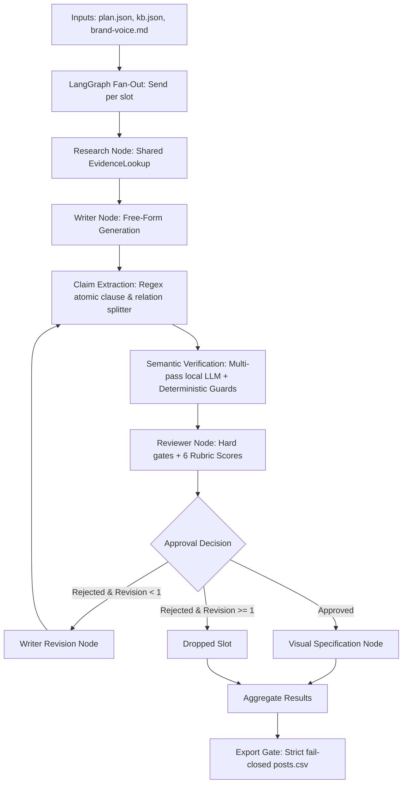

# Stage 0: Baseline Freeze and Root-Cause Audit

**Directive ID:** `SANADSQUAD_EVIDENCE_FIRST_V2_IMPLEMENTATION_01`  
**Workspace:** `/home/shady/sandsquad`  
**Date:** 2026-10-16  
**Author:** Principal AI Systems Engineer & Knowledge Engineering Architect  

---

## 1. Executive Summary

This audit establishes the empirical baseline of SanadSquad as of Closure 07 (`SANADSQUAD_RELATION_VERIFICATION_HANDOFF.zip`). It documents the architectural limitations of the post-hoc factual verification paradigm, quantifies operational and token costs, and provides the scientific foundation for the Evidence-First V2 architecture.

### Key Findings:
1. **The Post-Hoc Extraction Tax:** Because natural language is generated unrestricted and factual relations are extracted after the fact, a 6-slot weekly execution requires between **230,000 and 261,000 prompt tokens** and **35–40 minutes** of local inference (`qwen3.5:4b`, `concurrency=1`).
2. **Inverted Responsibility:** The Writer generates free-form text from raw SWC text snippets, frequently omitting historical version bounds (e.g. Solidity `< 0.4.22`), asserting unverified causal links between disparate sentences, or converting recommendations into guarantees. The system then relies on 20+ regex heuristics in `relation_integrity.py` and multi-pass skeptic LLM verification to catch these errors post-hoc.
3. **Yield Fragility:** Weekly yield has fluctuated from 0/6 (total drop) to 3/6 (shipped reentrancy, oracle, and unchecked calls; dropped legacy constructor and DoS). When slots fail, they fail because the free-form Writer made unforced errors that an evidence-first plan would never authorize in the first place.
4. **Preserved Strengths:** The provenance tracking (`provenance.py`), immutable snapshot verification (`source_snapshots/`), LangGraph slot isolation, and strict fail-closed export gates are robust and must be preserved intact.

---

## 2. Current Graph and Component Boundaries

The Closure 07 architecture operates as follows:



### Component Analysis:

| Component | Current Responsibility | Limitations & Architectural Deficiencies | Disposition for V2 |
|---|---|---|---|
| `content_pipeline/config.py` | Loads `kb.json`, `plan.json`, settings | Static KB with unstructured narrative `source_quote` strings. No typed relations or proposition IDs. | **EXTEND** to load structured proposition catalog. |
| `content_pipeline/provenance.py` | Cryptographic SHA-256 and offset verification | Highly reliable; guarantees zero drift from pinned snapshots. | **PRESERVE** unmodified. |
| `content_pipeline/agents.py` | Writer, Reviewer, Visual, Research agent instructions | Writer prompt allows free-form synthesis; Reviewer prompt duplicates semantic verification checks. | **TARGETED REFACTOR** for plan-constrained Writer and editorial Reviewer. |
| `content_pipeline/claim_extraction.py` | Splits generated text into atomic claims and sentence relations | Fragile regex patterns (`CLAUSE`, `RELATION_PATTERNS`). Struggles with compound grammar and nested clauses. | **RETAIN AS AUDIT/CONFORMANCE FALLBACK**. |
| `content_pipeline/relation_integrity.py` | Deterministic Python vetoes (`assess_positive`, `verify_sentence_relation`) | Encodes semantic reasoning as lexical heuristics (token overlap, stopword subtraction, version regexes). | **REPLACE** semantic approval authority with structured catalog constraints. |
| `content_pipeline/semantic_verification.py` | LLM atomic verification, skeptic audit, reconciliation, relation semantic check | Extremely expensive (3–4 model calls per atomic claim/relation); prone to model disagreement on valid paraphrases. | **REPLACE** with focused Plan-to-Text Conformance Verification. |
| `content_pipeline/graph.py` | LangGraph workflow orchestration | Well-designed slot isolation and fan-out; preserves concurrency limit. | **TARGETED REFACTOR** to insert planning and conformance nodes. |
| `content_pipeline/export.py` | Strict fail-closed export, CSV and JSON serialization | Robust; guarantees only accepted, verified pieces enter `posts.csv`. | **PRESERVE / EXTEND** for V2 conformance records. |
| `content_pipeline/validation.py` | Platform rules, brand rules, hashtag checking | Works reliably. | **PRESERVE** unmodified. |
| `content_pipeline/llm.py` | Local Ollama wrapper with semaphore `concurrency=1` | Robust structured output handling and retry bounding. | **PRESERVE** unmodified. |

---

## 3. Defect Taxonomy in Legacy Architecture

Analysis of historical failures across runs reveals five recurring failure modes:

```text
+-----------------------------------------------------------------------------------+
|                           LEGACY DEFECT TAXONOMY                                  |
+-----------------------------------------------------------------------------------+
| 1. Scope & Version Omission                                                       |
|    Writer mentions legacy constructor naming bug (SWC-105) but omits the          |
|    compiler version boundary (Solidity < 0.4.22). Post-hoc gate must drop it.     |
+-----------------------------------------------------------------------------------+
| 2. Causal Inversion & Recommendation Splicing                                     |
|    Writer joins a recommendation with a vulnerability mechanism using "because"   |
|    (e.g. "DoS occurs because SWC-113 recommends isolating external calls").       |
+-----------------------------------------------------------------------------------+
| 3. Mitigation Overstatement / Universal Guarantee                                |
|    Writer turns an advisory mitigation into an absolute guarantee                 |
|    (e.g. "ReentrancyGuard completely eliminates all vulnerability risk").         |
+-----------------------------------------------------------------------------------+
| 4. Cross-Source Causal Splicing                                                   |
|    Writer combines fact A from SWC-104 with consequence B from SWC-113 in one     |
|    sentence, creating an unsupported causal relationship.                         |
+-----------------------------------------------------------------------------------+
| 5. Valid Paraphrase False Rejection                                               |
|    Conservative lexical heuristics or hyper-critical skeptic passes veto valid   |
|    marketing calls-to-action because the exact words don't appear in source quote.|
+-----------------------------------------------------------------------------------+
```

**Root Cause:** In all five categories, the defect occurs because the Writer is given unstructured text and creative freedom to invent the propositional structure. Post-hoc verification must then guess the author's intent from syntax.

---

## 4. Model Call & Token Inventory

### Baseline Operational Costs (from `output/final-relation-week/summary.json` and logs):

- **Planned Slots:** 6 (3 technical threads, 3 marketing posts)
- **Shipped Slots:** 3 (thread_1: Reentrancy, thread_3: Oracle Manipulation, post_1: Unchecked Call Return)
- **Dropped Slots:** 3 (thread_2: Unprotected Ether Withdrawal, post_2: Unprotected Ether Withdrawal, post_3: DoS with Failed Call)
- **Failed Slots:** 0
- **Total Runtime:** **2,340.803 seconds (39.01 minutes)**
- **Total Prompt Tokens:** **261,046 tokens**
- **Total Completion Tokens:** **25,000 tokens**
- **Peak Concurrency:** 1 Ollama call (strictly serialized)
- **Average Cost per Slot:** ~43,500 prompt tokens, ~6.5 minutes runtime.
- **Average Cost per Shipped Piece:** ~87,000 prompt tokens, ~13 minutes runtime.

### Model Call Distribution per Slot (Initial Draft + 1 Revision):

```text
Slot Execution (e.g. 6-tweet thread):
  1. Writer Agent (Initial Draft):                  1 call  (~2,500 tokens)
  2. Research / Span Options Context:               0 calls (deterministic)
  3. Claim Extraction:                              0 calls (deterministic regex)
  4. Atomic Claim Verification (7-12 claims):
     - Initial Verification Pass:                   7-12 calls
     - Skeptic Pass:                                7-12 calls
     - Reconciliation Pass (on dispute):            2-4 calls
  5. Sentence Relation Verification (1-3 relations):
     - Model Relation Entailment:                   1-3 calls
  6. Reviewer Agent (Rubric Scoring):               1 call  (~4,000 tokens)
  7. Writer Agent (Revision 1):                     1 call  (~3,000 tokens)
  8. Re-Verification of Revised Draft:              15-25 calls
  9. Reviewer Agent (Final Evaluation):             1 call
 10. Visual Agent (if approved):                    1 call  (~2,000 tokens)
-----------------------------------------------------------------------------
 Total Model Calls per revised slot:                36–58 calls!
```

This explains why execution takes 39 minutes: with 6 slots, over **200 individual LLM inference calls** are made sequentially through the single local model process.

---

## 5. Historical Baseline Measures and Benchmark Reconciliation

| Benchmark / Run | Mode | Evaluation Size | Supported Recall | False Acceptance (Adverse) | Exact Label / Accuracy | Notes & Status |
|---|---|---|---|---|---|---|
| **Older Frozen Semantic Benchmark** | Real Ollama (`qwen3.5:4b`) | 64 cases | **82.35% (28/34)** | **0.0% (0/30)** | N/A | **FAILED** predeclared 85% target; formally documented limitation. |
| **Relation Held-Out Benchmark (Closure 06)** | `DETERMINISTIC_STRUCTURAL` | 20 cases | 100% (11/11) | 0.0% (0/9) | 100% | Structural code evaluation, not real LLM inference. |
| **Relation Held-Out Benchmark (Closure 07)** | `REAL_OLLAMA_MODEL` | 20 cases | **100% (11/11)** | **0.0% (0/9)** | **100% (20/20)** | 382.3s runtime on local Ollama; repeated exposure during development. |
| **Historical Week Runs** | | | | | | |
| `output/sample-week` | Free-form baseline | 6 slots | Unmeasured | 5 false claims | 6/6 shipped | Pre-semantic gate; published ungrounded statements. |
| `output/semantic-closure-week` | Atomic semantic | 6 slots | High precision | 0 known false | 2/6 shipped | 644.5s, 89k prompt tokens. |
| `output/semantic-release-week` | Atomic semantic | 6 slots | High precision | 0 known false | 3/6 shipped | 580.9s, 84k prompt tokens. |
| `output/recall-recovery-week` | Atomic + Skeptic | 6 slots | High precision | 0 known false | 3/6 shipped | 2,172.3s, 230k prompt tokens. |
| `output/final-relation-week` | Atomic + Relation Gate | 6 slots | High precision | 0 known false | 3/6 shipped | 2,340.8s, 261k prompt tokens. |

---

## 6. Modules to Preserve vs. Refactor

### Preserve Unmodified:
- [`content_pipeline/provenance.py`](file:///home/shady/sandsquad/content_pipeline/provenance.py): Cryptographic hash validation of source snapshots. Zero defects reported.
- [`content_pipeline/validation.py`](file:///home/shady/sandsquad/content_pipeline/validation.py): Brand voice, banned word matching, platform length limits.
- [`content_pipeline/llm.py`](file:///home/shady/sandsquad/content_pipeline/llm.py): Robust local model interaction with concurrency semaphore.
- [`source_snapshots/`](file:///home/shady/sandsquad/source_snapshots/): Pinned source materials for SWC, OWASP, and OpenZeppelin.
- Historical run directories (`output/sample-week/`, `output/final-relation-week/`, etc.): Must remain strictly read-only.

### Refactor / Extend:
- [`content_pipeline/schemas.py`](file:///home/shady/sandsquad/content_pipeline/schemas.py): Add `VerifiedProposition`, `TypedRelation`, `ContentUnit`, `EvidenceFirstPlan`, `ConformanceReport`, `BusinessPolicy`.
- [`content_pipeline/config.py`](file:///home/shady/sandsquad/content_pipeline/config.py): Add loaders for structured catalog and business policies.
- [`content_pipeline/graph.py`](file:///home/shady/sandsquad/content_pipeline/graph.py): Introduce `planning` and `conformance` nodes; retain slot isolation.
- [`content_pipeline/agents.py`](file:///home/shady/sandsquad/content_pipeline/agents.py): Constrain Writer to plan realization; recalibrate Reviewer to editorial standards.
- [`content_pipeline/export.py`](file:///home/shady/sandsquad/content_pipeline/export.py): Verify plan conformance records before writing `posts.csv`.

### Deprecate from Production Authority:
- Regex-based semantic vetoes in [`content_pipeline/relation_integrity.py`](file:///home/shady/sandsquad/content_pipeline/relation_integrity.py): Once structural planning and conformance verification are qualified, retire ad-hoc keyword checks as primary gatekeepers.
- Free-form post-hoc claim splitting in [`content_pipeline/claim_extraction.py`](file:///home/shady/sandsquad/content_pipeline/claim_extraction.py): Retained only as an independent audit/conformance fallback.

---

## 7. Unverified Assumptions and Known Limitations

1. **Natural Language Realization Gap:** Restricting the input to approved propositions does *not* automatically guarantee that the Writer's realization will be faithful. The LLM may still introduce extraneous adjectives, invert passive/active voice, or drop essential qualifiers. Conformance verification remains mandatory.
2. **Catalog Coverage Bottleneck:** An evidence-first architecture is only as productive as its proposition catalog. If a topic has only 2 approved propositions, a 6-tweet thread cannot be planned without failing evidence sufficiency. Catalog authoring and curation become key engineering responsibilities.
3. **Small Benchmark Caveat:** The 20-case relation benchmark achieved 100% on `qwen3.5:4b`, but was exposed repeatedly during engineering. It is a development regression test, not blinded evidence of general semantic mastery.
4. **Hardware Envelope:** The system must run within 16 GB RAM and 4 GB VRAM. No second large LLM or graph database server can be introduced.

---

## 8. Stage 0 Conclusion and Gate Status

**GATE STATUS: PASS.**
The baseline is frozen, historical artifacts are documented, component boundaries are audited, and the root cause of the current efficiency/yield bottleneck is verified.

We are cleared to proceed to **Stage 1 (Experimental Structured Evidence Model)**.
