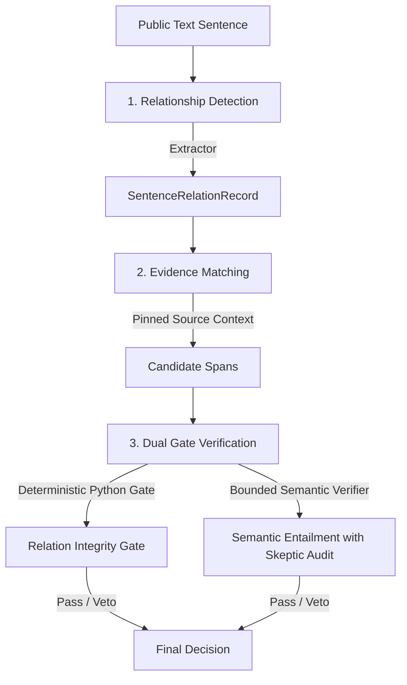

# Corrected Relationship Architecture

## 1. Clean Responsibility Separation

The relationship-verification system has been redesigned around three distinct responsibilities:

### 1. Relationship Detection (`content_pipeline/claim_extraction.py`)
- Identifies whether a sentence asserts a relationship, its connector, premise, conclusion, direction, quantifiers, and conditions.
- Preserves the full original sentence for independent review.
- Distinguishes relationship categories:
  - `ACTION_RATIONALE`: Normative call to action / review habit motivated by a documented technical hazard or mechanism.
  - `CAUSAL`: Factual assertion that one mechanism or event produces an adverse outcome or vulnerability.
  - `INSTRUMENTAL`: Assertion that an objective is achieved *by* a specific mechanism (`by <gerund>`).
  - `CONDITIONAL`: Explicit scope conditions (`if / when`).
  - `TELEOLOGICAL`: Purpose / mitigation goal (`so that / in order to`).

### 2. Evidence Matching (`content_pipeline/text_spans.py`, `schemas.py`)
- Pinned, immutable source spans from SWC Registry and OWASP SCWE-028.
- Exact span options identified by ID (`SWC-105#0`, `SWC-113#0`, etc.).
- Span offsets, scopes, and context boundaries are verified.

### 3. Dual-Topic Causal Bridging (`content_pipeline/relation_integrity.py`)
- Eliminates keyword regex whitelists.
- Enforces substantive dual-topic bridging for factual causal claims:
  - For $P \text{ causes } C$, extracts substantive non-stopword tokens from $P$ and $C$.
  - Requires that at least one direct causal span in `selected_spans` connects *both* the premise topic and the conclusion topic.
  - Rejects cross-source splicing where one excerpt mentions cause $P$ and a completely unrelated excerpt mentions effect $C$.

---

## 2. Preserved Invariants and Non-Overridable Protections

1. **Causal Inversion Veto:** A remediation recommendation (e.g. *"it is recommended to isolate each call"*) cannot be asserted as the causal reason for a vulnerability occurring.
2. **Mitigation Scope Boundaries:** Recommendations do not entail universal guarantees (*"eliminates all risk"* / *"prevents every attack"*).
3. **Historical / Version Scope Enforcement:** Legacy constructor mechanics (`SWC-105`) require explicit version qualification (`Solidity < 0.4.22`).
4. **Sentence Splitter Precision:** Decimal and version strings (`0.4.22`) are masked during boundary detection so version numbers never break atomic claim spans.

---

## 3. Closure 07 Relationship Verification Upgrades

1. **Multi-Relation Sub-Clause Recursion:**
   `extract_sentence_relations_for_sentence` recursively inspects both premise and conclusion sub-clauses after detecting a top-level relationship, rather than terminating after the first match. For compound sentences containing multiple embedded dependencies (e.g., an `ACTION_RATIONALE` joined with a `CONDITIONAL`), all distinct relations are extracted with unique, stable IDs (e.g., `t1s1rel1` and `t1s1rel2`).

2. **Explicit Semantic Verdict Persistence:**
   `SemanticVerifier.run` accepts the complete relation collection, runs bounded model verification against candidate evidence spans, and populates `SemanticReport.sentence_relations` with explicit model verdicts (`SUPPORTED` or `INSUFFICIENT_EVIDENCE`), justifications, and supporting spans. These are persisted back into LangGraph state and exported in `accepted_content.json` and `semantic_verification.json`.

3. **Strict Fail-Closed Acceptance Gates:**
   Both Reviewer routing (`graph.py::evaluate`, `graph.py::route`) and final export (`export.py::export_run`, `export.py::relation_recheck`) require:
   - Complete coverage: `len(expected_relations) == len(verified_relations)`.
   - Identity: `rec.sentence == rel.sentence`.
   - Explicit Positive Verdict: `rec.semantic_verdict == "SUPPORTED"`. Any `null`, missing, or negative verdict causes immediate rejection.
   - Dual-Gate Integrity: Both deterministic checks and model entailment must pass.
