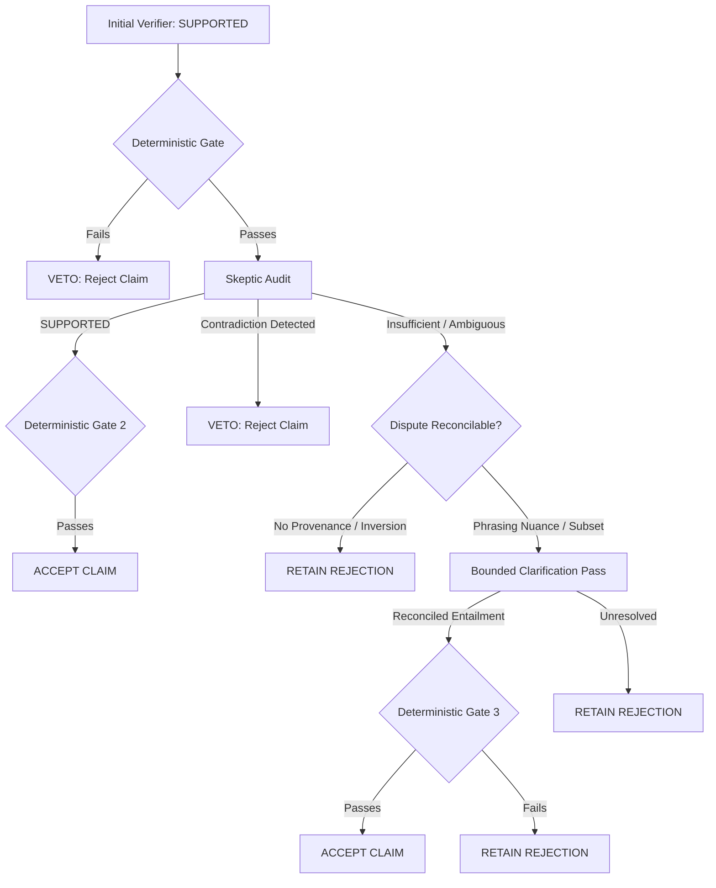

# Writer–Verifier Alignment & Evidence-First Planning

**Directive ID:** `SANADSQUAD_SEMANTIC_RECALL_RECOVERY_05`  
**Phase:** 4 — Writer & Research Alignment & Skeptical Calibration  
**Modules:** `content_pipeline/agents.py`, `content_pipeline/semantic_verification.py`, `instructions/`  
**Status:** Approved & Implemented

---

## 1. The Core Misalignment in Previous Passes

In Closure 03 & 04, the system suffered from a catastrophic divergence between the **Writer** and the **Semantic Verifiers**:

1. **Information Asymmetry:** The Research phase passed raw vulnerability records, but the Writer had no structured map of which points were descriptive facts, which were causal explanations, and which were normative recommendations.
2. **Unsupported Extrapolations:** In `thread_2` (Delegatecall/Reentrancy) and `thread_1` (Access Control), when evidence was sparse or truncated, the Writer attempted to bridge gaps by introducing plausible-sounding causal claims (e.g., *"The core risk is late state changes"* or *"Execution halts unexpectedly"*), which the relation gate or skeptic rightfully blocked.
3. **Hyper-Literal Skeptical Rejection:** The Skeptic prompt instructed the model to be so pedantic that standard technical synonyms (e.g., *"while active"* for *"before invocation is finished"*, *"loss of funds"* for *"loss of funds or data"*) were rejected as "contradictions" or "unsupported scope modifications".
4. **Binary All-or-Nothing Gate:** When the initial verifier found support and the skeptic hesitated due to minor phrasing nuances, the system unconditionally defaulted to rejection without any bounded clarification mechanism.

---

## 2. Evidence-First Writing Plan

To prevent the Writer from inventing unsupported bridges, we introduce an **Internal Evidence Plan** constructed deterministically from pinned, hash-verified authority prior to LLM drafting.

### 2.1 Evidence Plan Structure
For each topic, the Research-to-Writer pipeline produces a structured roadmap passed in `task["evidence_plan"]`:

```json
{
  "educational_progression": [
    {
      "step": 1,
      "role": "HAZARD_DEFINITION",
      "evidence_id": "SWC-107#0",
      "allowed_relations": ["DIRECT_DESCRIPTIVE_SUPPORT", "DIRECT_CAUSAL_SUPPORT"],
      "allowed_content": "Definition of reentrancy where external calls transfer control back into caller",
      "prohibited_inferences": ["Do not claim all external calls are exploitable", "Do not claim universal funds drain"]
    },
    {
      "step": 2,
      "role": "EXECUTION_MECHANISM",
      "evidence_id": "SWC-107#0",
      "allowed_relations": ["DIRECT_DESCRIPTIVE_SUPPORT", "EXECUTION_MECHANISM"],
      "allowed_content": "Control transfer before initial function execution finishes",
      "prohibited_inferences": ["Do not claim execution happens inside caller bytecode"]
    },
    {
      "step": 3,
      "role": "STATE_RISK",
      "evidence_id": "SWC-107#1",
      "allowed_relations": ["DIRECT_DESCRIPTIVE_SUPPORT", "CONSEQUENCE"],
      "allowed_content": "State variables can be updated after invocation or reentered unexpectedly",
      "prohibited_inferences": ["Do not assert late state changes are the root cause unless causal quote supports it"]
    },
    {
      "step": 4,
      "role": "MITIGATION_RECOMMENDATION",
      "evidence_id": "SWC-107#3",
      "allowed_relations": ["DIRECT_RECOMMENDATION", "CONTEXTUAL_SUPPORT"],
      "allowed_content": "Checks-effects-interactions pattern or reentrancy guards",
      "prohibited_inferences": ["Do not claim mitigation guarantees 100% prevention of all attacks"]
    }
  ]
}
```

### 2.2 Key Properties
- **Deterministic Derivation:** The plan is derived directly from the pinned `source_quote` records in `kb.json` using the syntactic and semantic categorizations in `content_pipeline/relation_integrity.py`.
- **Zero Hallucination:** The LLM does not generate the plan; it follows the pre-validated plan.
- **Fail-Early for Insufficient Topics:** If a topic lacks at least 5 distinct defensible points, the planner flags it before expensive LLM drafting, preventing wasted iterations.

---

## 3. Skeptical Verifier Calibration

The Skeptic prompt (`instructions/semantic-skeptic.md`) is calibrated to eliminate false pedantic rejections while strictly maintaining the causal-inversion veto:

### 3.1 Calibrated Boundaries
1. **Compatible Wording vs Contradiction:**
   - Standard domain synonyms (e.g., *"active execution"* for *"before invocation finishes"*, *"external contract"* for *"untrusted callee"*) are recognized as faithful paraphrases, NOT contradictions.
2. **Entailed Subsets & Disjunctions:**
   - If a source states an issue causes *"loss of funds or data"*, a claim asserting that it can cause *"loss of funds"* is **SUPPORTED** (a narrower disjunct is entailed by the source), provided modal qualifiers (`can`, `may`) are preserved.
3. **Review Actions vs Causal Claims:**
   - A marketing call to action derived from an identified risk (e.g., *"Review how your contract handles low-level call returns"*) is evaluated as a review action, NOT as an ungrounded root-cause claim.
4. **Preservation of Causal Inversion Protection:**
   - A remediation instruction (e.g., *"apply checks-effects-interactions"*) CANNOT support a claim that *"late state changes are the root cause"*. The skeptic strictly vetoes this.

---

## 4. Bounded One-Pass Relation Reconciliation

When the initial verifier returns `SUPPORTED` (and passes the deterministic relation gate) but the skeptic returns `INSUFFICIENT_EVIDENCE` or `AMBIGUOUS`:



### Reconciliation Rules:
1. **Preserve Both Records:** Both the initial verification pass and the skeptical audit pass are recorded in `SemanticVerdict.initial_pass` and `SemanticVerdict.skeptical_pass`.
2. **Only Bounded Single Attempt:** Exactly one relation-focused reconciliation query is permitted. No infinite loops or retries.
3. **No Overriding Contradictions:** If the skeptic detected an explicit contradiction (`contradiction_detected=True` or `relationship_verdict="CONTRADICTED"`), reconciliation is forbidden. The claim remains rejected.
4. **Mandatory Final Deterministic Gate:** The reconciled verdict must pass `assess_positive` in `content_pipeline/relation_integrity.py`.
